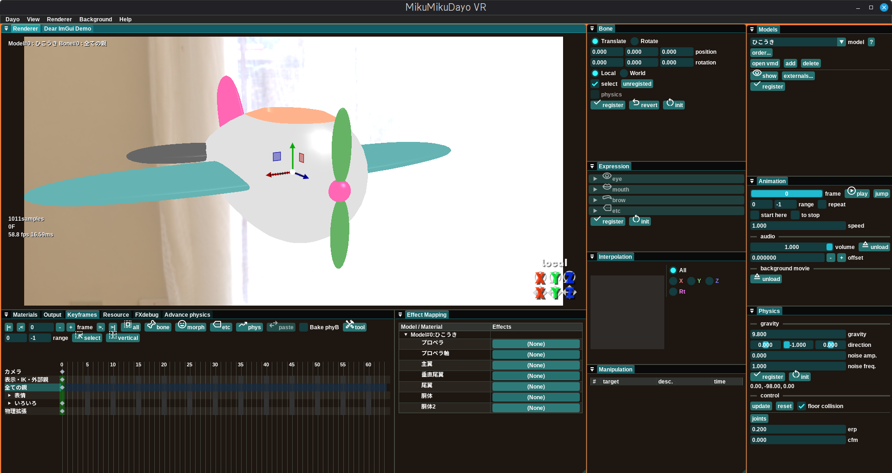

# MikuMikuDayo VR version 1.40-r261103

- **Windows Updateおよびグラフィックスカードのドライバは最新にしてください。「ちょっとくらい古くてもいいだろう」と思うかもしれませんが、レイトレーシングのドライバは意外とバグがまだ残っていて、ちょっとアップデートするだけでバグが治ってたりします。これまでのテストで得られた重要な知見ですからくれぐれもバグ報告などをする前にチェックしてください。**

## 目次

各項目の詳しい説明は折りたたまれています。▶ をクリックすると開きます。【VR】はMikuMikuDayo VRで追加・強化された機能です。

- [更新履歴](#更新履歴) … MikuMikuDayo VR / 本家MikuMikuDayo の更新履歴へのリンク
- [概要](#概要) … MikuMikuDayo VRとは、VR版で追加された主な機能
- [動作環境](#動作環境) … 必要なOS・GPU、DLSS/動画出力に関する補足
- [起動方法](#起動方法) … 起動とランタイム(DLL)の入手先
- [操作方法](#操作方法) … ファイルの読み込み、各メニュー、各ウィンドウの使い方
- [ポストプロセスとアップスケーラ](#ポストプロセスとアップスケーラ) … 【VR】ポストプロセスの実行順、FSR2/DLSS3.5の使い方、VR版で追加されたポストプロセス
- [MikuMikuDayoのエフェクトについて](#mikumikudayoのエフェクトについて) … deform / render / postprocess の考え方
- [VMDファイル読み込み・エクスポート時のコードページについて](#vmdファイル読み込みエクスポート時のコードページについて) … 他国語版モーションの文字化け対策
- [材質ファイルの書き方](#材質ファイルの書き方) … 材質注釈ファイルの書式
- [今後の予定](#今後の予定) / [多分対応しない事](#多分対応しない事)
- [構築方法](#構築方法) … ソースからのビルド方法と依存ライブラリ
- [付属のツールについて](#付属のツールについて) / [使用範囲](#使用範囲) / [謝辞](#謝辞) / [FAQ](#faq)

## 更新履歴
[MikuMikuDayo VR の更新履歴](HISTORY.md)

[MikuMikuDayo の更新履歴](https://github.com/pennennennennennenem/MikuMikuDayo/blob/main/update.md)

## 概要
MikuMikuDayoにVR180のレンダリング機能や動画出力機能を追加したものです

<b>VR版で追加・強化されている主な機能</b>

- **VR180パノラマ表示・出力** サイドバイサイドのVR180形式で表示・出力できます(`View`メニュー、VRウィンドウ)
- **動画ファイルの直接出力** 連番画像に加え、UtVideo(AVI)やProRes 4444(MOV)の動画ファイルを直接出力できます(Outputウィンドウ)
- **アップスケーラ対応** AMD FidelityFX Super Resolution 2.2(FSR2) と NVIDIA DLSS3.5 によるアップスケーリングに対応しています。対応レンダラは BDPT-L / Preview-L / Subayai-L です
- **Subayai-L** 画面に映っている発光材質を光源として扱う SS-VPL(Screen Space Virtual Point Light) を追加したレンダラです
- **拡張物理** 風や重力パレットを使い、剛体グループ単位で重力・風の影響を制御できます(Advance physicsウィンドウ)
- **FXLinker** 材質ごとにリムライトなどのエフェクトを割り当てられます(Effect Mappingウィンドウ)
- **キーフレーム編集の強化** キーのドラッグ&ドロップ移動、物理ボーンの焼き込み
- **UIのスケーリング、GPU選択、リソースモニタ**
- **Linux + Proton 対応**

## 動作環境
- Windows11　※ Linux + Protonでも動作します。ただしその場合デノイズがGPUではなくCPUで動作になります。
- DirectX raytracingのハードウェアサポート必須。具体的にはGeForceRTX2060以降です。Radeon+DXR環境でのテストはできてません。

<b>DLSS・動画出力についての補足</b>

- DLSS3.5を使う場合はNVIDIA GeForce RTXシリーズが必要です。また、DLSSに必要なDLL(`nvngx_dlss.dll`)はライセンスの都合でリリースパッケージに同梱していません。[NVIDIA DLSS 有効化ガイド](NVIDIA%20DLSS%20有効化ガイド.md)を読んで各自で配置してください
- 動画ファイルの直接出力にはFFmpeg(`ffmpeg\ffmpeg.exe`)を使用します。FFmpegはリリースパッケージに同梱しています(ライセンスは`ffmpeg\About_FFmpeg.txt`を参照してください)

## 起動方法
エクスプローラ上で`MikuMikuDayo.exe`をダブルクリック！  

- DLLが無くて起動しない場合は[こちら](https://learn.microsoft.com/ja-jp/cpp/windows/latest-supported-vc-redist?view=msvc-170)
- どれをダウンロードしたらいいのか分からない場合は多分[これ](https://aka.ms/vs/17/release/vc_redist.x64.exe)です
- 【VR】GPUが複数搭載されている環境では、初回起動時に使用するGPUを選択するダイアログが表示されます。選択内容は`config.json`に保存され、MikuMikuDayoを再起動すると反映されます(あとから`Dayo`メニューの`GPU選択...`で変更できます)

## 操作方法

項目名を見れば一目瞭然である物についての説明は割愛しています

### ファイルのドラッグ&ドロップ

エクスプローラから モデル・画像・音声・モーション・ポーズ・動画・プロジェクトファイル をドロップして読み込めます

エクスプローラからファイルのドラッグ&ドロップでアセット(モデルやテクスチャなどを総じてこの文書ではそう呼ぶことにします)の読み込みができます

- `pmx`ファイルをドロップするとモデルを追加します。PMX2.0/PMX2.1形式のみ対応しています(`pmd`や`x`は不可)
- `bmp`, `jpg`, `png`, `hdr`, `dds`ファイルをドロップすると背景として画像を追加します。背景画像の取り扱われ方はレンダラに依存します。標準で用意されているレンダラではskyboxとして使われます(`exr`にはまだ対応していません)
- `wav`, `mp3`, `m4a`ファイルをドロップすると音声データとして読み込みます。再生中に演奏される他、キーフレーム表示ウィンドウ上で波形を表示します
- `vmd`ファイルをドロップするとモーションデータとして編集対象となっているカメラ・光源またはモデルに読み込みます
- `vmdayo`ファイルをドロップすると、MikuMikuDayo独自形式のモーションデータとして読み込みます(`Dayo`メニューからエクスポートできます)
- `vpd`ファイルをドロップするとポーズデータとして現在のフレームに読み込み、登録します。Ctrl+Zでアンドゥできます
- `mp4`,`avi`ファイルをドロップすると背景動画データとして読み込みます、モデルのテクスチャにscreen.bmpが割り当てられている場合その内容が動画ファイルの内容になります。
- `dayo`ファイルをドロップするとプロジェクトファイルとして開きます

### メニュー

<b>Dayoメニュー</b> ― プロジェクト(.dayo)の読み書き、モーションのエクスポート、借り物リスト、GPU選択、設定

- 主にMikuMikuDayoのプロジェクトファイルである`dayo`ファイルの読み書きが出来ます。本家MMD+MMEでいう`pmm`ファイルと`emm`ファイルをくっつけたようなモノです
- MikuMikuDayo自体の設定(表示言語の設定など)ができます。UIの大きさや文字の大きさも変えられますので、デフォルトの文字サイズが小さい！など感じた人は設定で調整できます
- `VMD`ファイルフォーマットでモーションデータのエクスポートができます。本家MMDへデータをエクスポートしたい時にどうぞ
- 選択状態のキーをMikuMikuDayo独自形式の`vmdayo`ファイルにエクスポートできます。VMDでは表現できない補間方法(スプライン補間)やカメラのボーン追従なども保存されます
- 借り物のクレジットへの記載やニコニコ動画のコンテンツツリー登録に便利な`借り物リスト`を表示できます。プロジェクトファイルのフォルダとプロジェクトに読み込まれている`.pmx`ファイルと同じフォルダに置かれている`.url`ファイル(インターネットショートカット)を検索し、ファイル名部分をモデルの説明文(モデルの概要や作者名など)、リンク先URLからニコニコ動画の作品IDを抽出して一覧にします。`copy`ボタンでメモ帳にペーストするとクレジット表記やコンテンツツリー登録に便利なテキストとして出力されます。1つのモデルのフォルダに複数の`.url`ファイルがある場合は、すべて一覧に追加されます
- `スカイボックスを開く...` `オーディオファイルを開く...` でファイルダイアログから背景画像・音声を読み込めます
- 【VR】`GPU選択...` 使用するGPUを選択します。選択内容は`config.json`に保存され、MikuMikuDayoを再起動すると反映されます

`設定(Preferences)...` では以下を設定できます

- **Editor** カメラキーの常時表示、PrintScreenキーでのスクリーンショット、ギズモの移動・回転の刻み、アイコン付きボタンの外観(アイコンとラベル / アイコンのみ / ラベルのみ)
- **Resources** ミップマップの生成
- **Language** 日本語 / 英語
- **Scaling** 【VR】UIのスケーリング(DPI)
- **Infomation** 情報表示時の音声波形の表示と、前後何フレーム分を表示するか
- **Physics** 物理演算の内部fps、最大サブステップ数、再生・録画開始時の事前計算ステップ数
- **Save** 上書き保存時の確認、`.bak`ファイルの作成

フォントは`config.json`で指定します。`font`(日本語フォント)と`fontEN`(英字フォント)にはフォントのファミリー名(例:`"Yu Gothic"`)を指定し、`fontWeight`(太さ)、`fontSize`(大きさ)、`fontEmbolden`(太字化処理)も指定できます。【VR】日本語フォントが見つからない場合は、同梱の`font\NotoSansJP-Bold.ttf`で表示します

<b>Viewメニュー</b> ― 情報表示、剛体表示、物理演算・デノイザのon/off、パノラマ表示、描画解像度、動作モード

- **情報表示** Rendererウィンドウに表示fpsなどのデータを表示するようになります。音声データを読み込んである場合は音声データの波形を表示します
- **剛体表示** 物理剛体の状態が表示されます
- **モデル編集時カメラ・光源追従** モデル編集時もフレームを切り替えた際にキーフレームの状態にカメラ・光源の状態が合います
- **物理演算をする** BulletPhysicsによる物理演算処理を使用します
- **デノイザを使う** Intel Open Image Denoiseを用いたデノイズ処理を行います。効果はレンダラの実装に依存します
- **パノラマ表示** VR180用のサイドバイサイド パノラマ表示に切り替えます
- **(そのまま,1/2,1/4)の解像度で描画** 描画時の解像度をRenderウィンドウのサイズからさらに縮小して速度を向上させることが出来ます
- **動作モード** 
  - **サンプルためろ** 静止画用にサンプルを蓄積します。必要が無い限り物理演算などでモデルは動かない状態になります
  - **ガンガンいこうぜ** 常時物理演算などを行いモデルの状態は更新し続けられます。サンプルは蓄積されません
  - **でんきだいじに** サンプルの蓄積も常時物理演算も行われない省エネモードになります。操作性は最も良くなります

<b>Rendererメニュー</b> ― レンダラ(BDPT / BDPT-L / Subayai / Subayai-L / Preview / Preview-L)の選択

レンダラ(レンダリングに用いるエフェクト)を選択できます。レンダラ自体は各人で好きな実装を作って`renderer`フォルダに置くと使えるようになりますが、同梱のレンダラは以下の6つあります

- **BDPT** 双方向モンテカルロパストレーシングを用いたレンダラです。動作が非常に重いですが高品質です
- **BDPT-L** BDPTに対してFidelityFX Super Resolution 2によるアップスケーリングを可能としたレンダラです（動画書き出し時にFSR2が有効であれば内部解像度を下げてレンダリングします）。DLSS3.5によるアップスケーリングにも対応しています
- **Subayai** ラスタライザベースで部分的にレイトレーシングを用いた表現力があり高速なレンダラです。動画の作成に役立ちます
- **Subayai-L** Subayaiに対して、発光体からの配光を実施するレイトレーシングを追加したレンダラです。やや重くなりますが、動画の作成に役立ちます。また、FidelityFX Super Resolution 2によるアップスケーリングが可能です（動画書き出し時にFSR2が有効であれば内部解像度を下げてレンダリングします）。DLSS3.5によるアップスケーリングにも対応しています 画面に映っている発光材質を仮想点光源(SS-VPL)として周囲を照らします。本家Subayaiの変更にも追従しています
- **Preview** MMD用モデルを表示・確認するための軽いレンダラです。ある程度本家MMDに寄せてはありますが、特に互換性は無いのでご注意ください。ソースコードがシンプルなのでレンダラを自作する時の参考にどうぞ
- **Preview-L** Previewに対して、FSR2/DLSS3.5によるアップスケーリングを可能としたレンダラです

「-L」の付いたレンダラは、アップスケーラが必要とするジッタ付きの描画と動きベクトル(VelocityMap)を出力します。アップスケーラの使い方は[ポストプロセスとアップスケーラ](#ポストプロセスとアップスケーラ)を参照してください

BDPTを使う場合は、`postprocess/tonemapper/ACESTonemap.pmx`をドロップしてトーンマッパーを有効にしてください。また、`renderer/BDPT/dayorencon.pmx`もドロップすると露出補正や開口モーフによりDoF効果などの設定が行えます。

同様に、Subayaiを使う場合は、`postprocess/tonemapper/ACESTonemap.pmx`をドロップしてトーンマッパーを有効にしてください。また、`renderer/Subayai/subayairencon.pmx`もドロップすると露出補正などの設定が行えます。DoFについては`postprocess/DoF`にある物を使ってください。

<b>Backgroudメニュー</b> ― screen.bmpの扱い、背景の塗りつぶし方、背景のα=0出力

背景画像やMMDモデルの予約テクスチャ名`screen.bmp`を割り当てられた材質についての取り扱いを設定します。`screen.bmp`の内容は以下の基準に従って生成されます

1. 背景動画が読み込まれていない場合は前フレームにおけるレンダリング結果
2. 背景動画が読み込まれている場合は背景動画の内容
3. 以下のメニューの設定でscreen.bmpが無効になっている場合は白一色のテクスチャとする

以下、メニュー項目の説明です

- **screen.bmpを無効にする** screen.bmpを無効にします
- **screen.bmpをトリミングしない** そのまま使用します
- **screen.bmpを4:3でトリミングする** アクペクト比4:3でトリミングします
- **背景はレンダラのデフォルトにする** モデルが描画されていない部分はskyboxを表示するなどレンダラ実装依存の表示を行います
- **背景はscreen.bmpと同内容にする** モデルが描画されていない部分にscreen.bmpの内容を表示します
- **背景は白で埋める / 黒で埋める / チェック模様で埋める** モデルが描画されていない部分を指定の色・模様で埋めます
- **背景はα=0で出力する** モデルが描画されていない部分のα値は0として出力します。動画編集ソフトとの連携時に役立ちます。使用するレンダラ/ポストプロセスなどの実装によっては意図通りの結果が得られない事もありますのでご注意ください。

【VR】FSR2/DLSS3.5のアップスケーラを使う場合に背景を操作したいときは、アップスケーラ用に用意した`postprocess/FSR2/Background_for_FSR2.pmx`または`postprocess/DLSS3.5/Background_for_DLSS.pmx`を使ってください

<b>Helpメニュー</b> ― オンラインマニュアル・チュートリアル、ショートカット一覧、バージョン情報

- ショートカット一覧を表示してキーボードよる操作方法一覧を確認できます
- `マニュアルダヨ...` `チュートリアルダヨ...` で本家MikuMikuDayoのオンラインマニュアル・チュートリアルをブラウザで開きます
- `About MikuMikuDayo VR...` でバージョンや使用しているライブラリの情報を表示します

### 各ウィンドウの操作

MikuMikuDayoが無事に起動できると以下のようにメインウィンドウ全体の中に小さなサブウィンドウが沢山でてきます

画面のイメージとレイアウトのリセット方法

サブウィンドウは個々に移動やリサイズ、ドッキングが可能ですから好きにレイアウトしてください

ウィンドウのレイアウトをリセットしたい場合は、一旦MikuMikuDayo.exeを終了して、MikuMikuDayo.exeと同じフォルダにある`imgui.ini`を削除すると次回起動時にデフォルトのレイアウトが読み込まれます

ここから先の各ウィンドウの説明に出てくる「カメラ編集モード」「モデル編集モード」はModelsウィンドウで切り替えます

<b>Modelsウィンドウ</b> ― 編集対象(カメラ/モデル)の選択、モデルの追加・削除、処理順の設定、表示・IK・外部親、カメラの記録

編集対象のモデルを選択します。一番上の**Camera/Light**を選択するとカメラ・光源のキーフレームを編集するモード(以下、カメラ編集モード)になり、それ以外が選択されているとモデルのキーフレームを編集するモード(以下、モデル編集モード)になります

- `add` ファイルダイアログからモデルを追加します
- `?` モデル/エフェクトの説明文の表示、またはモデルの格納フォルダを開く操作を選択して実行します

モデル編集モードの場合、以下の機能もModelsウィンドウに付きます。
- **モデルの削除** MikuMikuDayoから対象のモデルを除去します(元のpmxモデルデータは削除されません)
- **順序の設定** `order`ボタンを押すと、モーションの解決順・ポストプロセスの実行順・デフォーマの実行順・ラスタライザの実行順(表示順)をそれぞれ設定出来ます。ドラッグ&ドロップで並べ替えを行い、ESCでウィンドウを閉じます(今の所、内容変更のキャンセルができません) `auto`ボタンを押すと、ポストプロセスの実行順をおすすめの順番に並べ替えます。`close`ボタンでもウィンドウを閉じられます
- **表示・非表示の選択** `visible`チェックボックスで選択し`register`ボタンを押すと現在のフレームに表示・非表示キーが登録されます。アイコン表示の設定では、目のアイコンのボタンで表示・非表示を切り替えます
- **IKのon/off** `IK`の見出しを開くと、モデルのIKボーンがチェックボックスで一覧表示され、on/offを切り替えられます。`register`ボタンで現在のフレームに登録します
- **外部親設定** `externals...`ボタンを押すと外部親設定ダイアログが開きます。編集中のモデルのボーンを他のモデルのボーンの子として制御できるようになります

カメラ編集モードの場合、以下の機能がウィンドウに付きます
- **再生中にカメラをマウスで動かせるようにする**
- **カメラの記録** `Animation`ウィンドウの再生範囲で指定された範囲の間のカメラのキーフレームを消去し、リアルタイムで記録した内容に上書します。カメラをマウスで操作し、スペースキーを押すとそのタイミングでキーフレームに書き込まれます。Ctrl+Zで上書き記録前の状態に戻せます。 

<b>Keyframesウィンドウ</b> ― キーの選択・編集、ツールボックス(位置・角度補正、速度調整など)、【VR】キーのドラッグ&ドロップ移動、物理ボーンの焼き込み

キーフレーム群に対する操作を行います。MikuMikuDayoでアニメーションを作成するにあたっては、キーフレームの集合としてモデル・カメラの運動を定義し、キーフレームを構成する個々の要素の事をMikuMikuDayoでは**キー**と呼びます

ボタンの上にマウスカーソルを合わせると各ボタンの機能やショートカットキーが表示されます

以下の機能があります

- **編集対象フレームの変更**
- **ボーンの選択**
- **キーの選択・削除・カット・コピー・ペースト**
  - Ctrl+ドラッグで範囲内のキーの選択状態を反転、Ctrl+クリックで1つのキーの選択状態を反転します
  - キーの種類ごとの一括選択ボタン(全キー / ボーン / 表情 / 表示・IK・外親 / 物理ボーン、カメラ編集モードではカメラ / 照明 / セルフシャドウ / 重力)があります。表情のボタンからは、目・口・まゆ・その他の表情モーフのキーだけを選択することもできます
  - `select` 選択状態のボーンについて、指定したフレーム範囲のキーを選択します
  - `vertical` 選択状態のキーと同じフレームにある別のボーンのキーも選択します
  - 左右反転ペースト(paste LR)
- **ツールボックス**(`tool`ボタン)
  - **位置・角度補正** 選択状態のキーの位置・角度(カメラの場合は注目点・角度・距離・視野角)に倍率とオフセットを掛けます
  - **速度調整** 指定したフレーム範囲のキーの間隔を伸縮して、モーションの速度を変更します
  - **表情大きさ補正** 選択状態の表情キーの値に倍率とオフセットを掛けます(0～1へのクランプも可)
  - **ランダムまばたき** 指定したフレーム範囲に、指定した頻度(回/分)で「まばたき」モーフのキーを生成します
  - **MorphEQ** 音声データの指定した周波数帯域の音圧から、選択状態の表情モーフのキーを生成します
  - **auto lip maker** 音声データから「あ・い・う・え・お」のリップモーフのキーを生成します
  - 旧VR版の「キーの補正(y=Ax+B)」(`correct bone/morph/cam`ボタン)は、ver1.40でこのツールボックスへ統合されました
- **【VR】キーのドラッグ&ドロップ移動** キーをドラッグして別のフレームへ移動できます。選択状態のキーを掴んだ場合は、選択されているキー全体をまとめて移動します。移動は同じ行の中だけで行え、折りたたまれた表示枠の行からは移動できません
- **物理ボーンの焼き込み**（`Bake PhyB`をチェックONしたままプレビュー再生すると、その間の物理ボーンを焼き込みします）
- **【VR】拡張物理のキー** モデル編集モードでは「advance physics」、カメラ編集モードでは「global advance physics」の行に、Advance physicsウィンドウで登録したキーが表示されます

1フレームあたりの時間は1/30秒で固定です

<b>Manipulationウィンドウ</b> ― キーフレームに対する操作の履歴(アンドゥの対象)

現在までキーフレーム群に対して行った操作の履歴が表示されます。新しい内容ほど上に表示され、Ctrl+Zキーを押したときにやり直しの操作の対象になる内容が白くハイライトされて表示されます

<b>Rendererウィンドウ</b> ― シーンの表示、視点操作、ギズモによるボーン操作、ボーンの矩形選択

シーンの表示やボーンの選択を行います。
- マウスの右ドラッグで視点の回転
- 中ドラッグで視点の平行移動
- 左ドラッグでボーンの矩形範囲選択。Shift+左ドラッグで矩形範囲を追加選択し、Ctrl+左ドラッグで矩形範囲の選択状態を反転します。Ctrl+Aで全ボーンを選択します

モデル編集モードではkeyframeウィンドウでボーンが1つ選択されている場合はボーンを操作するためのギズモが表示されます

ギズモ上でマウスの左ボタンをドラッグするとボーンの移動・回転を行い、右ボタンをクリックするとコンテキストメニューが開きます

- `register` ボーンに対する操作結果をキーフレームへ登録
- `revert` ボーンの状態をキーフレームの状態に巻き戻す
- `init` ボーンを初期状態にする

平行移動時のギズモの赤・緑・青各軸の矢印はX・Y・Z軸を表しており、矢印に黒い線が何本か入っている場合は各軸の⁻方向を示しています

また、右下のXYZと書いてある操作パネルで左ドラッグを行うとボーンの回転および平行移動を行うことが出来ます。Shift/Ctrlを押しながら操作すると早く/遅く操作が出来ます。複数のボーンが選択されている場合は、選択状態のボーン群をまとめて動かせます

<b>Boneウィンドウ</b> ― ボーンの位置・姿勢の数値編集、ギズモの操作モード、未登録ボーンの選択、物理のon/off

モデル編集モード時のみ表示されます。

Keyframeウィンドウでボーンを選択できる他、ボーン選択モードにチェックを入れるとボーンが選択されていない場合にはRendererウィンドウにボーンを選択するためのマーカーが表示されます。

- `position`, `rotation` ボーンが1つだけ選択されている状態ではボーンの位置・姿勢をそれぞれで編集できます
- `Translate`/`Rotate` ギズモの操作を移動/回転で切り替えます
- `Local`/`World` ギズモの操作軸をローカル/ワールド座標系で切り替えます
- `unregisted` キーフレームに登録されている状態と比較してボーンの状態が変化しているがキーフレームに未登録のボーンが選択されます
- `physics` ボーンの物理シミュレーション有効/無効を切り替えます
- `register` ボーンに対する操作結果をキーフレームへ登録
- `revert` ボーンをキーフレームの状態に巻き戻す
- `init` ボーンを初期状態にする

<b>Expressionウィンドウ</b> ― 表情モーフの操作と登録(目・口・まゆ・その他の枠ごとに一覧表示)

モデル編集モード時のみ表示されます。

表情モーフが目・口・まゆ・その他の枠ごとに見出しでまとめて一覧表示されます。見出しを開いてスライダーで影響量を操作し、各スライダーの右にある`register`ボタンでキーフレームへ登録します。

- スライダーを右クリックすると、そのモーフをデフォルト値に戻します
- ウィンドウ下部の`register`ボタンで全ての表情モーフを現在のフレームに登録し、`init`ボタンで全ての表情モーフを初期化します

<b>Cameraウィンドウ</b> ― カメラの注目点・姿勢・距離・視野角、ボーン追従、パースの有無

カメラ編集モード時のみ表示されます

- `target` カメラの注目している位置を設定します
- `rotation` カメラの姿勢を設定します
- `distance` カメラの注目している位置からカメラ自体の位置までの距離を設定します
- `FoV` 垂直画角を設定します
- `perspective` チェックを外すと平行投影になります

- `bone-tracking` カメラが`model`と`bone`で指定されたボーンの位置に張り付くようになります。`target`は注目点の位置ではなくボーンの位置からの相対位置として解釈されます

- `register` カメラの状態をキーフレームへ登録します
- `init` カメラの位置・姿勢を初期化します

<b>【VR】VRウィンドウ</b> ― VR180出力用の瞳孔間距離・パネルの視野角

カメラ編集モード時のみ表示されます

- `IPD` 瞳孔間距離を設定します。
- `centor panel FOV` 中央のパネルの視野角を設定します。
- `other panel FOV` 中央以外のパネルの視野角を設定します。

<b>Lightウィンドウ</b> ― 平行光源の色・向き

カメラ編集モード時のみ表示されます。平行光源の設定を行います。

*BDPTレンダラでの現在の実装では、この情報は特にレンダリング結果には反映されません*

- `color` 光源の色・明るさをRGBで設定します
- `direction` 光線の進行方向を設定します

光源情報の扱われ方はレンダラに依存します。

- `register` 光源の状態をキーフレームへ登録します
- `init` 光源の位置・姿勢を初期化します

<b>SelfShadowウィンドウ</b> ― セルフ影の計算方法と距離

カメラ編集モード時のみ表示されます

*BDPT,Previewレンダラでの現在の実装では、この情報は特にレンダリング結果には反映されません*

- `none`,`mode1`,`mode2` セルフ影の計算方法を3種類より選択できます
- `distance` セルフ影に対するパラメータを設定します

<b>Interpolationウィンドウ</b> ― 補間曲線の編集、スプライン補間の指定、補間曲線のコピー&ペースト

ボーンまたはカメラのキーを選択すると補間曲線の設定が出来ます。複数のキーを選択するとまとめて補間曲線を設定出来ます

ラジオボタンでキーのどの要素についての補間曲線を操作するのか選択できます。`All`を選択すると全ての要素を一括して設定出来ます

- `spline` 見出しを開いてチェックを入れた軸は3次スプライン補間(Catmull-Rom)になります。チェックの無い軸は従来どおりの補間曲線による補間になります
- `register` 操作結果をキーフレームに登録します(本家MMDとは違い、registerを押さないと編集フレームを切り替える際に操作内容は破棄されますのでご注意ください)。▼のメニューから「時間曲線のみ」「補間方法のみ」の登録も選べます
- `copy` 編集中の補間曲線を補間曲線用コピーバッファにコピーします
- `paste` 補間曲線をペーストします。▼のメニューから「時間曲線のみ」「補間方法のみ」のペーストも選べます
- `init` 補間曲線を直線に初期化します

<b>Animationウィンドウ</b> ― モーションの再生、再生範囲・速度、音声・背景動画の設定

モーションの再生および音声の設定を行います。

- `▶️` モーションの再生/停止を行います
- `frame`  再生中のフレーム番号の表示の他、スライダーとしてドラッグすると当該フレームの状態を表示できます
- `jump`   再生中のフレーム番号の位置に編集フレーム番号をジャンプさせます
- `range`  再生範囲を指定します-1を指定するとキーの打ってある最後のフレームとして解釈されます
- `repeat` 指定範囲を繰り返して再生します
- `start here` 編集中のフレームから再生を開始します
- `to stop` 再生を停止したフレームを編集対象のフレームにします
- `speed`  再生速度を指定します。1.000で等倍、2で2倍速となります
- `volume` 音声の再生ボリュームを指定します
- `offset` 音声の再生開始位置を秒単位で指定します
- `unload` 音声ファイルをMikuMikuDayoから除去します。元の音声ファイルは削除されません
- `background movie` の`unload` 背景動画をMikuMikuDayoから除去します。元の動画ファイルは削除されません

<b>Physicsウィンドウ</b> ― 重力の設定、物理演算の更新・リセット、床との当たり判定

物理演算の調整をします

- `gravity` 重力加速度の大きさを設定します
- `direction` 重力の働く方向を設定します。XYZの順に並んでおり、計算前に長さ1に正規化されます
- `noiseAmp.` 重力にノイズを付加する際の強度を設定します
- `noiseFreq.` ↑の変わりやすさを設定します
- `register` 重力の設定を現在のフレームにキーとして登録します
- `init` 重力の設定を初期化します
- `update` 1フレーム(1/30秒)の時間だけ物理演算の状態を進めます
- `reset` 物理演算の状態をリセットします
- `floor collision` 物理剛体と床との当たり判定をon/offします
- `joints` ジョイントの設定を行います(実験用)

<b>【VR】Advance physicsウィンドウ</b> ― 風と重力パレットによる拡張物理(全体設定・モデル別設定)、キーフレーム登録

拡張物理(風・重力パレット)の設定を行います。設定はキーとして登録でき、Keyframesウィンドウの「advance physics」「global advance physics」の行に表示されます

**Global Config**(全体設定、カメラ編集モードでキーを登録します)
- `Enable Wind` 剛体に風力を加えます。`Wind Force(X,Y,Z)`で風の向き、`Wind Strength`で強さを設定します
- `Gravity Palettes` 5つの重力パレット(P1～P5)の重力ベクトルを設定します。`Ovr`は標準重力を置き換え、`Add`は標準重力に力を加算します

**Model Config**(モデル別設定、モデル編集モードでキーを登録します)
- `Enable Local Control` モデルローカルの重力や風力を有効にします
- 剛体グループ(G00～G15)ごとに、使用する重力パレット(`Def`=標準重力、1～5=パレット)と風の効き具合を設定します。グループ名の右には、そのグループに属する代表的な剛体名が表示されます

キー操作ボタン
- `Reg` 現在の設定を現在のフレームに登録します
- `Del` 現在のフレームのキーを削除します
- `.<` `>.` 前/次のキーへ移動します
- `Cpy` `Cut` `Pst` キーのコピー・カット・ペーストを行います

<b>Outputウィンドウ</b> ― 連番画像・【VR】動画ファイルの出力

画像の出力を行います。連番の画像ファイルとして動画も出力できます。

- `filename` 画像を出力するファイル名を設定します。`(?)`にカーソルを合わせると表示される通り、この項目で設定したファイル名を元にした連番の画像として出力されます。ファイル名が数値で終わっている場合は、その数値から連番を開始します
- `samples` 1フレーム出力するために何回レンダリングして平均を取るかを設定します
- `motion blur` 1サンプル毎にモーションと物理の更新をし直すことでフレーム間の素早い動きも画面に描写します
- `range` 出力するフレームの範囲を設定します。-1を指定するとキーの打ってある最後のフレームとして解釈されます。静止画を出力したい場合は出力範囲を1フレーム分にしてください
- `resolution` 出力画像の解像度を設定します
- `fps` 動画のフレームレートを設定します(出力ファイルはあくまで連番画像なので動画編集ソフトで同じfpsになるよう設定してください)

※ 以下の段落は本家MikuMikuDayoでの方針です。MikuMikuDayo VRでは後述の通り動画ファイルを直接出力できます

連番の画像ファイルとしての出力しか出来ませんが、動画ファイルの直接出力については対応しないつもりです。特にBDPTでの出力にはかなり時間が掛かる事が想定されるので、途中でクラッシュした場合の被害がデカすぎるためです。toolフォルダを覗いてみると役立つものがあるかもしれませんが、基本的には動画編集ソフトを使ってくださいね。

**【VR】動画ファイルの直接出力**

MikuMikuDayo VRでは、上記に加えて動画ファイルを直接出力できます。`record`ボタンを押すと出力形式を選ぶダイアログが開くので、形式を選んで`Start Recording`を押してください(動画形式の場合は、続いて保存先のファイル名を指定します)。動画の出力にはFFmpegを使用します

| 出力形式 | 拡張子 | 特徴 |
|---|---|---|
| Image Sequence (PNG) | png/jpg | 従来どおりの連番画像 |
| UtVideo RGBA | avi | 可逆圧縮・α付き |
| UtVideo RGB | avi | 可逆圧縮・αなし |
| UtVideo YUV422 | avi | 可逆圧縮(YUV422) |
| UtVideo YUV420 | avi | 可逆圧縮(YUV420、一般的な形式) |
| ProRes 4444 | mov | 高画質・α付き |

FSR2/DLSS3.5のアップスケーラを読み込んでいる場合は、録画時のみ内部解像度を1/1.5に下げてレンダリングし、出力解像度へアップスケールします

<b>Materialsウィンドウ</b> ― 材質ごとの材質注釈(材質の質感設定)の割り当て

エフェクトによってはモデルの各材質単位でエフェクトに注釈データ(以下、材質注釈と呼びます)を付ける事が出来ます。(同梱のエフェクトとしてはβ3時点ではBDPTレンダラだけです)

現在の同梱レンダラでは、BDPT / BDPT-L / Subayai / Subayai-L が材質注釈に対応しています

材質名の右に材質注釈を書いたファイルを指定できるので、`renderer\m`フォルダ内にある材質注釈を設定出来ます。例えば金属的な質感にしたい場合は`metal.txt`を割り当てるとそのようになります

材質注釈ファイルの書き方については後述します

レンダラの切り替えなどでエフェクト自体がメモリから破棄されると設定されていた材質注釈も全部無くなるのでご注意ください。BDPTだと重いのでPreviewに切り替えたいと思ってもPreviewに切り替えると材質注釈はリセットされます。`View`メニューの`1/4解像度で描画`などを使ってください

<b>【VR】Effect Mappingウィンドウ</b> ― 材質ごとにリムライトなどのエフェクトを割り当てる(FXLinker)

リムライトなどモデルの材質単位でエフェクトを付けることができます。

各材質に適用したいエフェクトをこのウィンドウ内で設定し、**/MikuMikuDayoVR/UserEffects/AutoGenerated**フォルダ内に自動生成されている同名の**pmxファイル**読み込むとエフェクトが適用されます

ここで適用できるエフェクトの仕様については`UserEffects/FXLinker Manual_complex.md`を参照してください

<b>FXdebugウィンドウ</b> ― エフェクトのデバッグ(パス・テクスチャ・バッファ・コントローラの確認)

読み込まれているエフェクトの中身を確認するためのウィンドウです。エフェクトを自作する際に役立ちます

- `effect` 確認したいエフェクトを選択します
- `resource` 表示する内容を選択します
  - `Overview` エフェクトのカテゴリ、ポストプロセスの実行順のヒント(stage / subHintOrder)、共有リソースを表示します
  - `Passes` パスの構成を表示します
  - `Manual` エフェクトのマニュアルを表示します
  - `Controllers` コントローラ(モーフ)の値を表示します
  - テクスチャ・バッファを選ぶとその内容を表示します。テクスチャは表示倍率・明るさ(`scale`)・3Dテクスチャのスライス(`slice`)・ミップレベル(`mip`)を指定でき、`dump`で画像ファイルに保存できます。バッファは`float`/`int`/`hex`で数値表示します

<b>【VR】Resourceウィンドウ</b> ― メインメモリとGPUメモリ(VRAM)の使用量の表示

システムのメインメモリ(RAM)と、使用中のGPUのメモリ(VRAM)の使用量を円グラフで表示します。VR出力やアップスケーラの使用時はメモリを多く消費するので、目安にしてください

## ポストプロセスとアップスケーラ

<b>ポストプロセスの使い方と実行順</b>

ポストプロセス用の`.pmx`ファイルをドロップすると、そのポストプロセスが有効になります。同梱のポストプロセスの説明は[postprocess/postprocess.md](MikuMikuDayo/postprocess/postprocess.md)を参照してください

ポストプロセスの実行順はModelsウィンドウの`order`ボタンで開く順序設定ダイアログで設定します。`auto`ボタンを押すと、各エフェクトに設定されている実行順のヒント(`stage`と`subHintOrder`)に従って、おすすめの順番に並べ替えます

| stage | 主なエフェクト |
|---|---|
| first | 【VR】アップスケーラ用の背景の塗りつぶし(Background_for_*)など |
| scene | パーティクル、フォグなど、シーンに描き入れるエフェクト 【VR】Effect Mappingウィンドウで材質ごとに割り当てたエフェクト(FXLinker) |
| camera | DoF、グレア、モーションブラー、TAA、レンズフレアなど、カメラのレンズ・フィルム由来のエフェクト 【VR】アップスケーラ(FSR2/DLSS3.5)は、DoF・モーションブラーの後、レンズフレアなどの前に並びます |
| tonemapping | トーンマッパー |
| composition | FXAA、構図線など、トーンマッピング後に実行するエフェクト |
| last | 【VR】VerticalPreviewMask |

`auto`で並べた順番は目安です。使っているモデルや作品の内容によっては手動で並び替えてください

**【VR】パノラマ表示・VR出力で使う場合の注意**

TAA(`postprocess/TAA`、本家1.40で追加された、輪郭のギザギザを目立たなくするエフェクト)は、前のフレームの映像を重ね合わせて滑らかにする仕組みです。パノラマ表示やVR出力では映像のずれやにじみが出て正しく効かないため、通常表示で使ってください

<b>【VR】アップスケーラ(FSR2・DLSS3.5)の使い方</b>

1. 「-L」の付いたレンダラ(BDPT-L / Preview-L / Subayai-L)を選択します
2. `postprocess/FSR2/FSR2_Upscaler.pmx`(FSR2)または`postprocess/DLSS3.5/DLSS3_5_Upscaler.pmx`(DLSS3.5)をドロップします。DLSS3.5を使う場合は、事前に[NVIDIA DLSS 有効化ガイド](NVIDIA%20DLSS%20有効化ガイド.md)に従ってDLLを配置してください
3. 背景を操作したい場合は、アップスケーラ用に用意した`Background_for_FSR2.pmx`または`Background_for_DLSS.pmx`を使います

プレビュー中は等倍の解像度でレンダリングし、録画時のみ内部解像度を1/1.5に下げてレンダリングして出力解像度へアップスケールします。VRパノラマ表示・VR出力時は、面ごとに独立してアップスケーリングを行います(メモリ使用量がかなり多くなるのでご注意ください)

**ポストプロセスの実行順とアップスケーラの関係**

順序設定ダイアログでアップスケーラより**前**に並べたポストプロセスは拡大前の小さい画像に、**後**に並べたポストプロセスは拡大後の大きい画像に掛かります

- **アップスケーラより前に置くべきエフェクト** どのモデルのどの材質が映っているか、カメラからどれだけ離れているか(奥行き)といった、シーンの情報を使って掛けるエフェクトです。例：輪郭線、リムライト(Effect Mappingで割り当てるエフェクトなど)、フォグ、パーティクル、被写界深度(DoF)、モーションブラー これらのシーンの情報は拡大されても細かくならないため、アップスケーラより後に置くと、DoFのピントの境目やモーションブラーの輪郭などがガタガタになってしまいます
- **アップスケーラより後に置くべきエフェクト** 画面の色と明るさだけを加工するエフェクトです。カメラのレンズやフィルムで起こる現象を再現するものが当てはまります。例：レンズフレア、色収差、トーンマッピング、カラーグレーディング、ノイズ付加

`auto`ボタンで並べると、フォグ・パーティクル・Effect Mappingのエフェクト・TAA・DoF・グレア・モーションブラーがアップスケーラより前に、レンズフレアなどのレンズ系エフェクト・トーンマッパー以降がアップスケーラより後に並びます

FSR2/DLSS3.5には、TAAと同じように前のフレームの映像を使って輪郭のギザギザを目立たなくする働きも含まれています。アップスケーラと`postprocess/TAA`は併用しないでください

<b>【VR】VR版で追加されたポストプロセス</b>

- **FXLinker**(Effect Mappingウィンドウで割り当てるエフェクト) モデルの材質ごとに、輪郭線やリムライト(モデルの縁を光らせる表現)などのエフェクトを付けられます。MMEで材質ごとにエフェクトを割り当てていたのに近い使い方ができます。Effect Mappingウィンドウで材質ごとにエフェクトを選び、`UserEffects/AutoGenerated`フォルダに自動生成されるpmxファイルを読み込むと有効になります。エフェクトの強さなどは、そのpmxのモーフで調整します これらのエフェクトはポストプロセスとして動作するので、他のポストプロセスと同じく順序設定ダイアログで実行順を変えられます(`auto`ではフォグやパーティクルと同じグループに並びます) 同梱のエフェクトは`UserEffects`フォルダにあります
  - `PostEdge` アニメ調の輪郭線
  - `PostRimLight2D` / `PostRimLight2D_withBlur` 2Dリムライト(ブラー付き版は光がやわらかくにじみます)
  - `DistanceFog` カメラから離れるほど霧がかかる距離フォグ
- **diffusion_AL**(`postprocess/glare`) 明るい部分だけを、光があふれ出すようにふわっと光らせるエフェクト(いわゆるブルーム)です。MMEのAutoLuminousに近い効果ですが、光らせたい部分をモデル側で指定する必要はありません。材質注釈で設定した発光の強さなど、レンダラの材質設定によって明るく描かれた部分がそのまま光ります
- **VerticalPreviewMask**(`postprocess/PreviewMask`) ショート動画など縦長(9:16)の動画を作るときに、横長の画面のまま仕上がりの範囲を確認できるよう、9:16の範囲の外側を覆い隠します。`Opacity`で覆う濃さ、`ColorR/G/B`で覆う色を設定します
- **Background_for_FSR2 / Background_for_DLSS** アップスケーラを使っているときに、背景を白・黒・チェック模様・screen.bmpで塗りつぶせます

## MikuMikuDayoのエフェクトについて

hlslで自作できるエフェクトの分類(deform / render / postprocess)と、設計上の考え方・注意点

hlslで自作することが出来ます！

MMEと互換性はありません！

今のところ、エフェクトは以下のように分類されます

- **deform** 
モデルの頂点情報と変換行列などからモデルの変形を行うエフェクト、モデルごとに別のエフェクトを設定出来ます
- **render** 
モデルの座標やテクスチャ、カメラの位置といった情報を元に画面の描画を行うエフェクトです。1つのレンダラを全部のモデルに適用します
- **postprocess** 
レンダラで出力した画像を加工して色調の補正などを行うエフェクトです。モデルや材質ではなく画面自体に掛かります

本家MMD+MMEでは各モデルの各材質ごとにエフェクトを指定し、変形と描画を一気に行っていました。このためパーティクルエフェクトを作ってパーティクルを構成するポリゴンの頂点を動かしたとして、パーティクルエフェクトの外からはモデル本来の頂点情報しか分からないので、パーティクルになる予定だった頂点群があるものとしてそのままポストプロセスなどが掛かっていわゆる**連凧**が現れたりしました

MikuMikuDayoではdeformとrenderを分離することでこの問題を解決しましたが、renderは材質や物体単位で別の物にすることが出来ず、全ての物体を同じシェーダで描画します。レイトレーシングでは物体が相互に反射する様子を考慮する事が大前提であるため、1つの物体だけ違う仕組みでレンダリングしようとすると、見た目に明らかにおかしな状態になるためです。HUDの表示などシーンと独立した表示内容の作成にはポストプロセスをうまく使った方がいいでしょう

色空間はsRGBリニアを念頭に置いています。ガンマでは無いのでピクセルシェーダ・レイトレーシングシェーダの入出力時にはご注意ください

本家MMEで使われていたMicrosoft純正のエフェクトフレームワークと比べるといまいちイケてなく感じるでしょう。なにしろあっちはコンパイラをいじって使い勝手を向上させていますから、それよりいいものは個人には作れませんが、Jsonnetのお陰で大分いいところまで来たと思います。

GPUがハングアップすると復帰する手立てが無いので、エフェクトの書き方が原因で無事MikuMikuDayoごと落ちる事もそこそこあります。エフェクトをいじる時は必ず作業中のデータを保存してからにしてね。

ポストプロセスのエフェクトでは、`fx`の`stage`と`subHintOrder`で実行順のヒントを指定できます(本家1.40で追加)。順序設定ダイアログの`auto`ボタンはこのヒントに従って並べ替えます

## VMDファイル読み込み・エクスポート時のコードページについて

他国語版モデル専用のモーションが正しく扱えない場合は、config.jsonのコードページ設定を変更します

VMDファイルに格納されているボーン名・モーフ名を示す文字列はANSIでエンコードされているため、VMDファイル内にボーン名として格納されているバイト列と表示される文字列との対応は環境により異なる可能性があります。これに対応できるよう、VMDファイルが作成された際に使われていたコードページが何であるかを`config.json`内の`vmd_codepage`で指定できるようになっています  

デフォルトでは日本語(Shift-JIS)を示すコードページ932が指定されていますが、もし他国語版モデル専用のモーションが正しく扱えない場合は、`config.json`内の`vmd_codepage`を変更すると解消できるかもしれません  

※ 現在の`config.json`では、この項目の名前は`vmdCodepage`です

## 材質ファイルの書き方

材質注釈ファイルの書式と、レンダラごとのテンプレートの場所

値パラメータ名:値  
_Tテクスチャパラメータ名:ファイル名

という形式でUTF-8エンコードされたテキストファイルに記述します

レンダラによって受付可能なパラメータは異なりますので、`renderer/BDPT/m/_template.txt`または`renderer/Subayai/m/_template.txt`を参考にしてください。BDPTとSubayaiでは共通するパラメータも多いですが完全な互換性があるわけではない事に注意してください。

Subayai-Lでは`renderer/Subayai-L/m/_template.txt`、BDPT-Lでは`renderer/BDPT-L/m/_template.txt`を参考にしてください

## 今後の予定
そのうちなんとか実現したいとぼんやり思っている事
- 動画ファイルの直接出力 ： できるようになりました

## 多分対応しない事

pmmファイルの読み込み、MMEからのエフェクト変換、X・PMD形式への対応

 - pmmファイルの読み込み  
エフェクトに互換性が無いのでpmmファイルを直接読み込めることにはあまり意味がないと考えています

- MMEからエフェクトの変換  
新しいエフェクトが作られる事を期待していますが、そのうちAIが勝手にやってくれるようになる日が来るかもしれません

- X,PMD形式への対応  
両者とも古い形式であり、PMXEditorで容易にPMXヘ変換できますから対応の必要はないと考えています

## 構築方法

ソースコードからビルドする方法と必要なライブラリ(本家MikuMikuDayoの手順)

`src`ディレクトリにソースコードが入っています  
レンダラ自体のソースは`dayo.cpp`と`*dayo.h`です  
全く整理されてないので無理して自分でビルドしなくてもいいです  

シェーダのソースコードは`MikuMikuDayo\hlsl`に入っています  
VisualStudio2022でのビルドを念頭にしています  

1. Visual Studioを起動し `新しいプロジェクトの作成` → `C++` `空のプロジェクト` を作成
1. プロジェクトの`プロパティ` → `リンカー` → `システム` → `サブシステム`を「コンソール」から「Windows」に変更
1. プロジェクトの`プロパティ` → `C/C++` → `言語` で`C++言語標準`をC++20、`準拠モード`を「はい」
1. ソリューションエクスプローラでプロジェクトの`ソースファイル`に`dayo.cpp` `*dayo.h` `*.ixx` を追加

ビルドするために以下も必要です  

- [DirectXTex](https://github.com/microsoft/DirectXTex)(desktop_win10を選択)
- [DirectX12Tk](https://github.com/microsoft/DirectXTK12)収録のSimpleMath.cpp,SimpleMath.h,d3dx12.h
- [BulletPhysics](https://github.com/bulletphysics/bullet3)
- [Intel open image denoise](https://www.openimagedenoise.org/)(OIDN)
- [ImGui](https://github.com/ocornut/imgui)
- [ImGuizmo](https://github.com/CedricGuillemet/ImGuizmo)
- [Cereal](https://uscilab.github.io/cereal/)
- [Jsonnet](https://jsonnet.org/)

DirectX TexはNuGetでプロジェクトに追加するのが簡単でしょう。`プロジェクト`→`NuGetパッケージの管理`で出来ます。

SimpleMath.cpp, SimleMath.h, d3dx12.hについてはDirectX12Tkから3つのファイルをコピーしてプロジェクトのソースファイルに入れればOKです  

BulletPhysicsは付属のcmakeのオプションだとDirectXTex等と一緒に使えないライブラリが出力されるのでPMXLoader.ixxの先頭付近に書いてある方法を使ってビルドしています。詳しいニキはcmakeのオプションいじって解決するとコンパイルがちょっと早くなっていいかもね  

OIDNについては上記リンクよりダウンロードしたoidn-(バージョン番号).x64.windows.zipを展開し、oidn.hppにインクルードパスを通し、OpenImageDenoise.libにライブラリパスを通せばOKです  

Cereal, ImGui, ImGuizmoのプロジェクトへの追加方法は各ドキュメントにある通り、プロジェクトのソースファイルに追加するだけです。ImGuiのbackendsにはimgui_impl_dx12とimgui_impl_win32を使ってください

Jsonnetはvcpkgでインストールすると良いでしょう。[こちら](https://github.com/google/jsonnet/tree/master?tab=readme-ov-file#packages)に詳しく書いてあります

## 付属のツールについて
toolフォルダにツール類が付属しています。詳しくは当該フォルダの`readme.txt`をどうぞ

## 使用範囲

MITライセンスで公開されたソフトウェアであり、無保証・無サポートです。

このソフトウェアを使用して作った画像や動画についてはこのソフトウェアの作者は何ら権利も義務も持ちませんから、各自の責任で使って下さい 

同梱しているライブラリ・フォントなどのライセンスは`licence`フォルダを参照してください

## 謝辞

MMD界隈の皆様、MikuMikuDayoの作者 サンドマン様、利用しているOSSの皆様への謝辞

MikuMikuDanceの作者 樋口様をはじめとする、MMD界隈の皆様に感謝いたします

MikuMikuDayo VRの制作にあたっては、コードを公開してくださっている、MikuMikuDayoの作者 サンドマン様に感謝いたします

構築方法の項にある通り、MikuMikuDayo VRは他にも幾つものOSSを利用して作られています。それらの作成・維持・管理に携わる皆様に感謝します

誠にありがとうございます  

## FAQ

ドライバの更新、動作環境、MMDとの関係、Z軸の向き など

- **Windows Updateおよびグラフィックスカードのドライバは最新にしてください。「ちょっとくらい古くてもいいだろう」と思うかもしれませんが、レイトレーシングのドライバは意外とバグがまだ残っていて、ちょっとアップデートするだけでバグが治ってたりします。β1テストで得られた重要な知見ですからくれぐれもバグ報告などをする前にチェックしてください。** 

- **動かないんですけど**  
DXR対応ビデオカードが無いと動かせないんですけど  

- **DXR対応ビデオカードのはずなんですけど**  
そんなら動くはずなんですけど、ヨソでテストはしてないんですけど  

- **MMD関連ソフトですか？**  
それは間違いないと考えています  

- **MMD互換ソフトですか？**  
ミクさんとミクダヨーさんの関係に似ていないこともないと思います  

- **MMDですか？**  
MikuMikuDayoです  
略す時はMMDayoと書いて下さい  
Dayoはそれ以上略せないんダヨー  

- **オープンソースですか?**  
ソースを公開してればオープンソースの定義には当てはまるようです。

- **Z軸の向きが逆じゃないですか?**  
Z+の方向に青矢印を表示しています(本家MMDでは青矢印の方向はZ-です)。ちなみに、矢印にギザギザと-が付いている場合は軸のマイナス方向を示しています。

