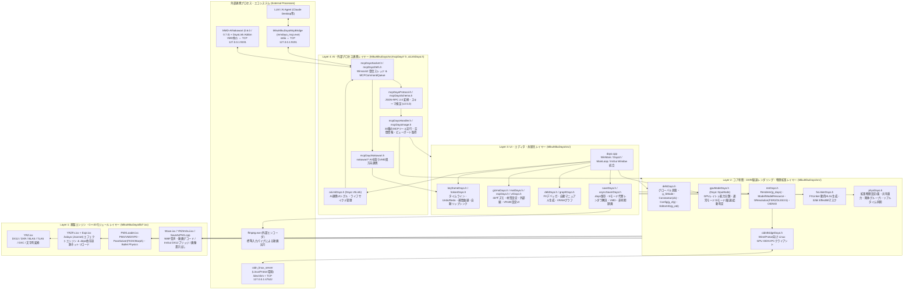
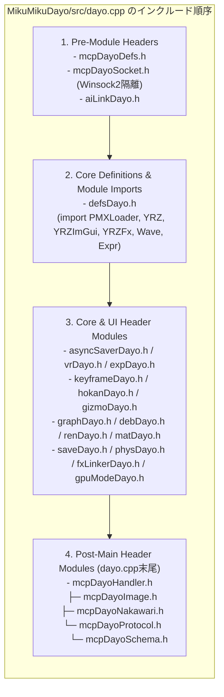

# MikuMikuDayo VR アーキテクチャ設計書 (Part 1: Module Composition & Function Mapping)

## 1. ドキュメントの目的と適用範囲
本ドキュメントは、**MikuMikuDayo VR（MMDayo）**（`Ver1.4.0-r261122` 時点）の全体アーキテクチャ、4層レイヤー構造、C++20モジュール群（`.ixx`）、アプリケーション層ヘッダモジュール群（`src/*Dayo.h`）、および外部連携プロセス群の責務と関数マッピングを体系的に定義する。

MMDayoは、単一のメイン翻訳単位（`MikuMikuDayo/src/dayo.cpp`）から各機能別ヘッダ（`*Dayo.h`）をインクルードする**ヘッダモジュール統合アーキテクチャ**と、基盤エンジン層をカプセル化する**C++20 Modules（`MikuMikuDayo/lib/*.ixx`）**のハイブリッド構成を採用している。本設計書により、機能追加・改修時に「どのレイヤーのどのファイル・関数を調査・変更すべきか」を即座に特定できることを目的とする。

---

## 2. システム全体レイヤー構造（4層＋外部エコシステム）

MMDayoのソフトウェアスタックは、下位の基盤エンジン層から上位の外部AI/プロセス連携層までの**4層構造**で構成される。

---

## 3. ビルド構成・インクルード順序・文字コード制約（重要設計原則）

### 3.1 単一翻訳単位（Single Translation Unit）とC++20 `import` の順序制約
`MikuMikuDayo.vcxproj` では、アプリケーション本体は `MikuMikuDayo/src/dayo.cpp` を中心とする単一翻訳単位としてコンパイルされる。
このとき、`defsDayo.h` の先頭で C++20 モジュール群（`import PMXLoader; import YRZ; import YRZImGui; import YRZFx; import Wave; import Expr;`）がインポートされるため、**MSVCのC++20モジュール仕様に伴う以下のインクルード順序制約**を厳守しなければならない。

1. **Winsock2および標準ヘッダ衝突の回避（`defsDayo.h` より前にインクルードするヘッダ）**:
   - `mcpDayoDefs.h`、`mcpDayoSocket.h`、`aiLinkDayo.h` は、**必ず `dayo.cpp` の最上部（`defsDayo.h` より前）**でインクルードする。
   - 理由：`YRZ.ixx` 等のモジュールが内部で `<Windows.h>` や `using namespace std;` を保持しているため、`defsDayo.h` の後で `<winsock2.h>` をインクルードするとマクロ再定義や `std::bind` と Winsock `::bind` の曖昧性エラーが発生する。
2. **`import` 後の標準ライブラリヘッダ再インクルード禁止（`defsDayo.h` より後にインクルードするヘッダ）**:
   - `defsDayo.h` 以降にインクルードされるヘッダ（特に `dayo.cpp` 末尾でインクルードされる `mcpDayoHandler.h` およびそこから参照される `mcpDayoProtocol.h`、`mcpDayoSchema.h`、`mcpDayoImage.h`、`mcpDayoNakawari.h`）では、モジュール側のグローバルモジュールフラグメント（GMF）と競合する標準ヘッダ（例：`<set>` 等）を新規に `#include` してはならない（MSVC `C2953` / `C2572` テンプレート再定義エラーの原因となる）。必要な場合は `std::vector` + `std::find` 等で代替する。

### 3.2 文字コード（UTF-8 with BOM）規約
- `MikuMikuDayo.vcxproj` には `/utf-8` コンパイラオプションが付与されていない（一方、`MikuMikuDayoMcpBridge.vcxproj` には `/utf-8` がある）。
- そのため、`MikuMikuDayo/src/` 配下のソース・ヘッダファイルに日本語コメントや `u8"..."` リテラルを記述する場合は、MSVCがCP932（Shift-JIS）と誤認して文字化けやコンパイルエラーを起こすのを防ぐため、**必ず UTF-8（BOM付き）** で保存すること。

---

## 4. モジュール構成一覧（Module Catalog）

### 4.1 Layer 1: 基盤エンジン・C++20モジュール群（`MikuMikuDayo/lib/`）

| ファイル名 | モジュール名 / 種別 | 行数目安 | 主な責務・提供クラス |
| :--- | :--- | :---: | :--- |
| `YRZ.ixx` | `export module YRZ;` | ~8,650 | DirectX 12 & DXR基盤。`YRZ::App`（ウィンドウ・入力・フレーム管理）、`YRZ::DXR`（デバイス・コマンドリスト・ディスクリプタヒープ・BLAS/TLAS・各種バッファ/テクスチャ生成・DXCシェーダコンパイル）、`YRZ::StopWatch`、UTF-8/ワイド文字列変換（`YRZ::u8`, `YRZ::L`）、ガウス乱数（`YRZ::Gaussian`）。 |
| `YRZFx.ixx` | `export module YRZFx;` | ~6,770 | `.fxdayo`（Jsonnet形式）エフェクトエンジン。`YRZ::FX`（レンダーパス・コンピュート/レイトレパス・リソース構築と実行）、`YRZ::FXWatcher` & `YRZ::FXShaderCache`（ファイル監視・`#include` 依存ファイル `.deps` 追跡付きシェーダキャッシュ・ホットリロード管理）、`YRZ::FXMatDesc`（材質記述子）、`YRZ::FXController`（UIスライダー連動パラメータ）。 |
| `PMXLoader.ixx` | `export module PMXLoader;` | ~6,890 | PMX 2.0/2.1 モデルおよび VMD/VPD モーション基盤。`PMX::PMXModel`、`PMX::VMD`、`PMX::Pose`、`PMX::KeySubset`、`PMX::KeyUndo`、`PMX::ISolver`（`PMX::PoseSolver` によるモーフ・ボーンFK/IK・付与解決、`PMX::CameraSolver`）、`PMX::Physics`（Bullet Physics `btDiscreteDynamicsWorld` ラッパー）。 |
| `Wave.ixx` | `export module Wave;` | ~1,380 | Windows Media Foundation (WMF) / XAudio2 / D3D12 Video を用いた音声・動画デコードおよび再生。`Wave::Data`（16bit Stereo PCM保持）、`Wave::Player`、`Wave::Movie`、`Wave::GPUMovie`（背景動画・テクスチャ動画デコード）。 |
| `Expr.ixx` | `export module Expr;` | ~535 | `YRZFx` 内でバッファサイズ計算や動的パラメータ評価に用いられるスタックマシン型数式コンパイラ＆エバリュエータ（`Expr::Compiler`, `Expr::Expr`）。 |
| `YRZImGui.ixx` | `export module YRZImGui;` | ~425 | `YRZ::DXR` と Dear ImGui のブリッジ。ディスクリプタヒープ割り当て、`YRZ::ImGuiTextureID`、`YRZImGui::RenderMarkdown`（デバッグウィンドウ内の自動生成マニュアル描画）を提供。 |
| `SaveAsPNG.cpp` | C++翻訳単位 | ~60 | `stb_image_write` の実装ユニット（`stbi_write_png_to_func`, `stbi_write_jpg_to_func` 等）。 |

---

### 4.2 Layer 2: コア状態・DXR/縮退レンダリング・物理拡張レイヤー（`MikuMikuDayo/src/`）

| ファイル名 | 主なクラス・構造体・グローバル変数 | 主な責務 |
| :--- | :--- | :--- |
| `defsDayo.h` | `Constantan` (`cb`), `Config` (`g_cfg`), `EditorInfo` (`g_edi`), `VRParam` (`vrParam`), `Translation` (`g_hon`), `KeyBind` (`g_KeyBinds`), `g_SMode`, `SModeRenderers`, `AppTitleBase`, `SModeSubstituteRenderer`, `WID_RENDERER` (-2), `IDX_CAMERA` (-1) | アプリ全体の定数、フィーチャーフラグ（`DXR_REQUIRED`, `MCP_REQUIRED`, `OIDN_LINUX_BRIDGE`）、Sモード（縮退モード）状態・利用可能レンダラ制限（`EnumRenderer`）、GPU定数バッファ構造体、環境設定（`config.json`）、プロジェクト設定（`.dayo` JSON部）、多言語辞書（`res/translation.json`）、ショートカットキー判定を集約。 |
| `gpuModeDayo.h` | `Dayo::GpuMode` (`RTClass`, `Mode`, `Request`, `AdapterInfo`, `Decision`, `EnumerateAdapters`, `Classify`, `Decide`, `ToGPUInfoList`) | 起動時に全DXGIアダプタのD3D12 FL12_0対応・`RaytracingTier`・`SV_Barycentrics` 対応を調査し、レイトレ能力を3段階（`HW` / `Emulated` / `None`）に分類。`config.json` の `renderMode`（`"auto"` / `"dxr"` / `"s"`）と `targetGpuName` に基づき、通常モード（`Mode::Normal`）かSモード（縮退モード、`Mode::S`）かおよび使用GPUを決定する。 |
| `renDayo.h` | `Renderer` (`g_dayo`), `Model`, `ModelResource`, `SResolution`, `OIDNIO`, `EnvMapSwarm` | シーン内の全PMXモデル管理、7ステージレンダリングパイプライン実行（通常モードでのDXRパスおよびSモードでの非DXRラスタ/コンピュート描画、DXR有無を問わないSkybox `PrefilterEnvmap` IBLミップ生成）、超解像（AMD FSR2 13コンテキスト / NVIDIA DLSS 3.5）、AIデノイザー（Intel OIDN 2.5.0 Shared/HostCopy）、TLAS/BLAS更新、ピッキング（`peekaboo`）を担当。 |
| `fxLinkerDayo.h` | `Dayo::FXLinker` (`g_fxLinker`), `LinkedEffectSlot` | ポストプロセスエフェクトのモデル別・材質別マスク適用（最大32スロットの `effectBits` ビットマスク管理）と、複数エフェクトを1パスで合成するHLSL/fxdayo（`UserEffects/AutoGenerated/FX_Composite_*.hlsl`）の動的コード生成。 |
| `physDayo.h` | `PhysicsSettingData`, `GlobalPhysicsData`, `PhysicsPresets` (`g_physPresets`), `PhysicsWorldDebugDrawer` | グローバル物理（風機能・5系統の共有重力プリセット）とモデル別物理（16剛体グループの重力割り当て・個別パラメータオーバーライド）のリアルタイムBullet同期およびプリセット保存。 |
| `oidnBridgeDayo.h` | `OIDNBridgeClient` | Wine / Steam Proton 環境（`OIDN_LINUX_BRIDGE` 有効時）において、`winevulkan.dll` からDX12アダプタLUIDに対応するPCIバス情報を特定し、Linux側の `oidn_linux_server` と `/dev/shm` 共有メモリ＋TCP（`127.0.0.1:47522`）で高速GPUデノイズを行うIPCクライアント。 |

---

### 4.3 Layer 3: UI・エディタ・永続化レイヤー（`MikuMikuDayo/src/`）

| ファイル名 | 主なクラス・構造体・関数 | 主な責務 |
| :--- | :--- | :--- |
| `dayo.cpp` | `WinMain`, `Dayo2`, `Camera`, `UpdateProjectSettings`, `NewProjectSettings`, `RenderEye` | アプリケーションのエントリポイント、`Dayo::GpuMode::Decide` による起動モード＆GPU初期化、メインループ、メインメニューバー、各種ImGuiウィンドウ（Camera / Light / SelfShadow / Renderer / Expression / Models / Order setting / Animation / Output / Manipulation / Physics）、VR180 2眼×6パネル描画ループ、録画ループの統合制御。 |
| `keyframeDayo.h` | `KeyFrameWindowContext` (`kc`), `KeyFrameUndoBuffer` (`g_undoBuffer`), `KeyFrameCopyBuffer` (`g_copyBuffer`), `KeyFrameWindow`, `g_sceneRevision` | 9種類のキーフレームマップを抽象化する `KeysVariant` とツリー構造（`KeyFrameNode`/`KeyFrameLeaf`）、パック対応Undo/Redo、タイムラインUI、および各種アニメーション補助ツール（位置角度補正・時間伸縮・表情スケーラー・ランダムまばたき・MorphEQ・音声解析オートリップシンク）。 |
| `hokanDayo.h` | `InterpolationEditor` (`g_hokanEditor`) | キーフレーム間の3次ベジェ補間曲線エディタUI、および補間方式（Bezier / Catmull-Rom / Linear）の切り替えとクリップボードコピー。 |
| `gizmoDayo.h` | `Gizmo`, `BoneWindow`, `DrawMarkers`, `RectSelectBones`, `DrawRigidBodies` | ImGuizmoを用いた3Dビューポート上のボーン移動・回転マニピュレータ、2Dボーンマーカー描画・矩形選択、剛体ワイヤーフレーム表示、数値入力によるボーン操作UI。 |
| `matDayo.h` | `MatDescWindow` | モデル材質ごとの `.fxdayo` / `.json` マテリアルプリセット割り当て、コピー＆ペースト、ドラッグ＆ドロップ適用、選択材質のハイライト表示。 |
| `expDayo.h` | `ExpWindow` | モデルのボーンを別モデルのボーンに追従させる「外部親（External Parent）」設定モーダルUI。 |
| `vrDayo.h` | `VRWindow` | VR180パノラマ出力時の瞳孔間距離（IPD）、BaseFov、CentorFov設定UI。 |
| `debDayo.h` | `DebugImageProcessor` (`DebIP`), `DebugWindow` (`FXdebug`) | `.fxdayo` 内の任意のGPUテクスチャ（2D/3D/MIP/チャンネル別）やバッファのリアルタイムインスペクタ、シェーダコンパイルログ表示、およびエフェクト定義から自動生成されるMarkdownマニュアル表示。 |
| `graphDayo.h` | `ResourceGraph::ResourceWindow` (`g_resWin`) | `IDXGIAdapter3::QueryVideoMemoryInfo` を用いた専用VRAM・共有GPUメモリ使用量のリアルタイム推移グラフ表示。 |
| `saveDayo.h` | `SaveDayo`, `LoadDayo`, `LoadDayoContext`, `RetargetRendererPath`, `ExportVMDayo`, `ImportVMDayo`, `ResolveFXPath` | `.dayo` プロジェクトファイル（JSONヘッダ＋バイナリキーフレームのハイブリッド形式）の保存・非同期分割ロード、Sモード時のDXRレンダラ自動代替（`Subayai*` ➔ `Subayai-S` 等）と材質参照先フォルダの自動付け替え（`RetargetRendererPath`）、欠損ファイルのスマートパス解決、独自拡張チャンク付きVMD（VMDayo）の入出力。 |
| `asyncSaverDayo.h` | `AsyncSaver` (`g_saver`) | 8スロットのリングバッファとD3D12 Fenceによる非同期GPUリードバック、マルチスレッドPNGエンコード、および `ffmpeg.exe` パイプ連携による高品質動画（HAP / ProRes / AVI）録画。 |

---

### 4.4 Layer 4: AI・外部プロセス連携レイヤー（`MikuMikuDayo/src/mcpDayo*.h`, `aiLinkDayo.h`, 外部ツール）

| ファイル名 / ディレクトリ | 主なクラス・関数 | 主な責務 |
| :--- | :--- | :--- |
| `aiLinkDayo.h` | `Dayo::AILink` (`Init`, `Shutdown`, `DrawMenuBarItem`, `ProcessFrame`) | メニューバー右端の `AI Link` トグルボタン制御と、`127.0.0.1:9191` リスナーの起動・停止・状態遷移（`OFF` / `ON` / `...` / `ERR` / `N/A`）管理。 |
| `mcpDayoDefs.h` | `MCPCommand`, `MCPCommandQueue` (`g_mcpQueue`) | ネットワークスレッドとメインスレッド間でJSON-RPCリクエストを受け渡すスレッドセーフキュー。 |
| `mcpDayoSocket.h` | `InitMCP`, `ShutdownMCP`, `ClientConnection`, `g_fastResponder` | Winsock2によるTCP `127.0.0.1:9191` サーバー実装（1接続1リクエスト改行区切りJSON-RPC 2.0）。キャッシュ応答用のファストパスフック（`g_fastResponder`）を備える。 |
| `mcpDayoSchema.h` | `MCP_SCHEMA_VERSION` (`"2.5.0"`), `GetToolsJson`, `GetResourcesJson` | 全30種のMCPツール定義・リソース定義を保持するSingle Source of Truth（本体と `MikuMikuDayoMcpBridge` の双方から共有インクルード）。 |
| `mcpDayoProtocol.h` | `MCP::Protocol::Adapt`, `ValidateToolArguments`, `RoundNumbers` | 標準MCPプロトコル（`tools/call`, `resources/read` 等）のアンパック、入力スキーマ検証、出力浮動小数点数の4桁丸め（トークン節約）、`CallToolResult` ラッピング、応答漏れ防止ガード（`ResponseGuard`）。 |
| `mcpDayoHandler.h` | `ProcessMCPCommands` | メインスレッド末尾でキューからコマンドを取り出し、キーフレーム操作・プレビュー姿勢操作・物理ベイク・カメラ/照明制御・空間情報取得・ビューポートキャプチャ等の全30ツールと9リソース（固定4＋テンプレート5）を実行するディスパッチャ。 |
| `mcpDayoImage.h` | `MCPImage::ResizeRGBA`, `EncodePNG`, `EncodeJPEG`, `Base64Encode` | `get_rendered_view` ツール向けに、GPUリードバックしたRGBA画像をメモリ上でバイリニア縮小し、PNG/JPEG圧縮＋Base64エンコードしてAIへ返却するヘルパー。 |
| `mcpDayoNakawari.h` | `MCP::Nakawari::Dispatch`, `FastRespond`, `PublishSnapshot` | 同一ポート `9191` 上で `nakawari/*` メソッドを処理し、外部AI中割りツール **MMD-AINakawari (`DayoLink`)** とローカル一時VMDファイルを介してボーンモーションの差分適用・1ステップUndo連携を行うモジュール。 |
| `MikuMikuDayoMcpBridge/` | `mmdayo_mcp.cpp` (`mmdayo_mcp.exe`) | Claude Desktop等のMCPホストと標準入出力（stdio）で通信し、MMDayo本体のTCP `9191` へリクエストを中継する軽量ブリッジプロセス。MMDayo未起動時でも `initialize` や `tools/list` に即応可能。 |
| `tools/oidn_linux_server/` | `oidn_linux_server` | Linux / Steam Proton環境向けに、ネイティブLinux側のCUDA/HIP/SYCL/CPUを用いてIntel OIDNを実行するデーモンサーバー。 |
| `tools/ainakawari_dayolink/` | `dayolink/` Pythonパッケージ & パッチ | MMD-AINakawari（0.6.0 / 0.7.0 両対応）側に「Dayoと通信」UIを追加し、`nakawari/*` JSON-RPCでMMDayoと直接モーションを送受信するアドオン。 |

---

## 5. 主要関数のモジュール別マッピング（Function Mapping）

### 5.1 エントリポイント・GPUモード決定・メインループ（`dayo.cpp`, `gpuModeDayo.h`）
- **`WinMain` / `Dayo2`**:
  - `config.json` と `res/translation.json` の読み込み、`Dayo::AILink::ApplyStartup()` の実行後、`Dayo::GpuMode::Decide(renderModeReq, YRZ::L(g_cfg.targetGpuName))` を呼び出して全GPUアダプタを調査し、起動モード（`g_SMode`）と使用GPUを決定する。
  - 複数枚の適合GPUが存在し `targetGpuName` が未設定の場合は `SelectGpuModal` を表示する（通常モードではHW-RT対応GPUのみ、Sモードでは全FL12_0対応GPUを候補表示）。
  - `YRZ::App` 生成後に `AppTitleBase()` でウィンドウタイトル（Sモード時は `"MikuMikuDayo VR [S mode]"`）を設定し、`YRZ::DXR dxr(app.hWnd(), !g_SMode, gpuName)` を初期化する。さらにGPUの `SV_Barycentrics` 非対応時には `-D NO_BARYCENTRICS`、Sモード時には `-D DAYO_SMODE` をシェーダ `CompileOption` へ追加した上で `Renderer` (`g_dayo`) を構築し、`MainLoop` ラムダを実行する。
- **`UpdateProjectSettings` / `NewProjectSettings`**:
  - 出力解像度（`g_edi.outputWidth/Height`）やレンダラ（`.fxdayo`）、アップスケーラ（FSR2/DLSS3.5）の変更時に、GPUフラッシュ（`g_dxr->Flush()`）を経て出力バッファ群（`g_dayo->ResizeOutput`）、OIDNバッファ、超解像コンテキストを再構築する。
- **`RenderEye`**:
  - 1視点（通常時は1回、VR180時は左目6パネル＋右目6パネルの計12回）分のカメラ行列・プロジェクション行列・`cb.ViewID` をセットアップし、`g_dayo->Render` を呼び出す。

### 5.2 レンダリング・モデル・シェーダ管理（`renDayo.h`, `YRZFx.ixx`, `renderer/*.fxdayo`）
- **`Renderer::Setup`**:
  - レンダラ `.fxdayo`（通常モード：`BDPT`, `Subayai`, `Subayai-L`, `Subayai-S`, `Preview` 等／Sモード：`Preview`, `Subayai-S`, `colorbar`）のロード、環境マップ群（`EnvMapSwarm`）、共有バッファ（`lightBuf`, `matBuf`, `morphBuf`, `boneBuf`, `peekabooBuf`）、および各種レンダーターゲット（`dxrout`, `oidnBuf`, `ppIn/Out`, `ppIn/Out_HighRes`, `finalVRScreen` 等）の生成。
  - Skyboxテクスチャ読み込み時の `PrefilterEnvmap`（ラフネス別IBLミップ生成）はピクセルシェーダのみで完結するため、DXR対応の有無（通常モード / Sモード）を問わず実行される。
- **`Renderer::Render`**:
  - 1フレーム（またはVRの1パネル）の7ステージレンダリングパイプラインを実行する中核関数（詳細は Part 3 参照）。
- **`Renderer::LoadPMX`**:
  - PMXファイルの読み込み、`Model` / `ModelResource` の生成、初期キーフレーム登録、材質記述子（`FXMatDesc`）のリンク、拡張物理データの初期化、およびアップスケーラダミーモデル（`FSR2_Upscaler.pmx` / `DLSS3_5_Upscaler.pmx`）の自動検出を行う。
- **`Renderer::UpdateBLAS` / `Renderer::UpdateTLAS`**:
  - 通常モード（`g_dxr->RaytracingSupport() == true`）では、スキニング後の頂点バッファ（`vb[flip]`）から各モデルのBLASを再構築・更新し、全モデルのインスタンスを束ねたTLAS（`m_tlas`）を構築する。SモードではBLAS/TLAS構築をスキップし、ダミーTLAS（`dmyTlas`）をバインドした上でマテリアル・モーフ・ボーンの統合StructuredBufferのみをGPUへアップロードする。
- **`YRZ::FXShaderCache::RecallItems` / `Load`**:
  - シェーダコンパイル時に `IncludeHandler::IncludedFiles` から全 `#include` 先ファイル（`SubayaiExtraHelper.hlsli`, `SubayaiSHelper.hlsli` 等）を `cache/<hash>.<entrypoint>.deps` に保存し、次回ロード時にエフェクト本体だけでなくインクルード先ヘッダのタイムスタンプ更新・削除も検知して自動再コンパイルを行う。
- **`SResolution::DispatchFSR2` / `SResolution::DispatchDLSS3`**:
  - ポストプロセスチェーンの途中で低解像度レンダリング結果を最終出力解像度へ超解像拡大する。

### 5.3 キーフレーム・タイムライン・アニメーション補助（`keyframeDayo.h`, `hokanDayo.h`）
- **`KeyFrameWindowContext::Init`**:
  - カメラ（`iModel == IDX_CAMERA`）またはPMXモデル（`iModel >= 0`）の対象キーフレームマップを `KeysVariant` として束ね、UI表示用のツリー構造（`KeyFrameNode` / `KeyFrameLeaf`）を構築する。
- **`PutKeyFrameCell` / `KeyFrameWindow`**:
  - ImGuiカスタム描画によるひし形キーフレームセルの描画、矩形ドラッグ複数選択、ドラッグ＆ドロップによる一括フレーム移動、およびタイムラインウィンドウ全体のUI制御。
- **`KeyFrameUndoBuffer::Record` / `Undo` / `Redo`**:
  - 変更前後の `PMX::KeyUndo` スナップショットを記録・復元し、同時に `BumpSceneRevision()` を呼び出して `g_sceneRevision` をインクリメントする。
- **アニメーション補助ツール群（`keyframeDayo.h`）**:
  - `PositionAngleAdjuster::Apply`（全フレームの位置・角度オフセット/スケール一括補正）
  - `TimeStretcher::Apply`（指定区間キーフレームの時間伸縮と物理状態リセット）
  - `ExpressionScaler::Apply`（指定モーフの区間スケーリング）
  - `ApplyRandomBlinks`（ガウス分布を用いた自然なランダムまばたき生成）
  - `MorphEQWindow`（イコライザー形式での複数モーフ一括加算・乗算・キー打鍵）
  - `BiquadBandPass` / `EnvelopeFollower` / `SimplifyMorphKeys`（WAV音声のフォルマント帯域解析による母音「あ・い・う・え・お」自動リップシンク生成とRDPアルゴリズムによるキー間引き）

### 5.4 ファイル入出力・録画パイプライン（`saveDayo.h`, `asyncSaverDayo.h`）
- **`SaveDayo` / `LoadDayo` (`LoadDayoInitialize` / `RetargetRendererPath`)**:
  - `.dayo` ファイルへのCereal JSON＋バイナリチャンク保存と、`LoadDayoContext` ステートマシンによる非ブロッキング段階ロード（UIのローディング進捗表示を維持したままモデル・エフェクトを順次ロード）。
  - Sモード起動中にDXR専用レンダラ（`Subayai`, `Subayai-L`, `BDPT` 等）で保存された `.dayo` を開いた際、`LoadDayoInitialize` が `SModeSubstituteRenderer()` で代替レンダラ（`Subayai-S` または `Preview`）へ自動置換し、さらに `RetargetRendererPath()` によって `WID_RENDERER` の材質設定ファイルパスを代替レンダラのフォルダ（例：`renderer/Subayai-S/m/...`）へ自動付け替えする。
- **`ExportVMDayo` / `ImportVMDayo`**:
  - 標準VMDフォーマットの後方に、MMDayo独自のコントローラ・照明・拡張物理・カメラ拡張キーフレームを付与した拡張VMDファイルの入出力。
- **`AsyncSaver::RequestSave` / `WaitSlot` / `SaveWorker`**:
  - GPUテクスチャからリードバックヒープへの非同期コピー、ワーカースレッドでのPNG書き出し、または `ffmpeg.exe` 標準入力パイプへのRAW RGBAフレーム流し込みを行う。
