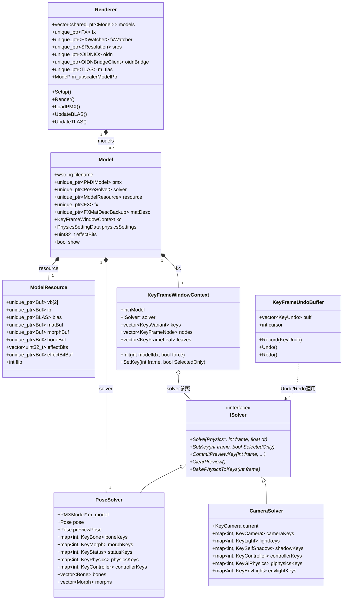
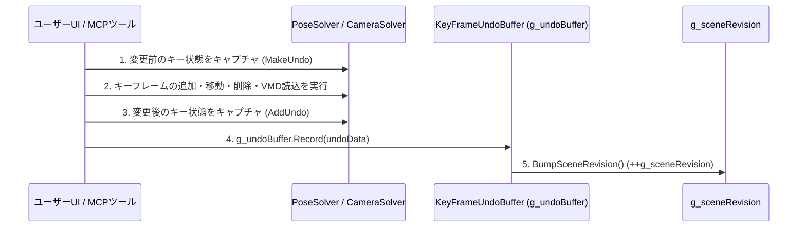

# MikuMikuDayo VR アーキテクチャ設計書 (Part 2: Data Structures & Keyframe Management)

## 1. ドキュメントの目的
本ドキュメントは、**MikuMikuDayo VR（MMDayo）**（`Ver1.4.0-r261122` 時点）におけるコアデータ構造、クラス間の所有・参照関係、9種のキーフレームを一元管理する `KeyFrameWindowContext` と `KeyFrameUndoBuffer` の仕組み、および設定・プロジェクトデータの永続化構造（`Config` / `EditorInfo` / `.dayo` ハイブリッドフォーマット）を定義する。

---

## 2. コアデータ構造・クラス関係図

MMDayoの中心となる `Renderer` (`g_dayo`)、各PMXモデルを表す `Model`、アニメーション計算を担う `PMX::PoseSolver` / `PMX::CameraSolver`、およびUI側のタイムライン状態を持つ `KeyFrameWindowContext` の関係は以下の通りである。



---

## 3. 主要データ構造の詳細

### 3.1 グローバル状態・定数バッファ・設定構造体（`defsDayo.h`, `gpuModeDayo.h`）

| 構造体 / 変数名 | インスタンス名 | 永続化先 | 主な保持データと役割 |
| :--- | :--- | :--- | :--- |
| `Constantan` | `cb` | なし（毎フレームGPUへ転送） | カメラ行列（`view`, `proj`, `invView`, `invProj`, `prevViewProj`）、カメラ位置・FOV、太陽光の向きと色、環境光パラメータ、フレーム番号（`iFrame`）、蓄積サンプル数（`iSample`）、経過時間（`frameTime`, `realTime`）、VR/パノラマ用パラメータ（`ViewID`, `eyeOffset`, `IPD`）等を格納するシェーダ定数バッファ（`b0`）。 |
| `Config` | `g_cfg` | `config.json` | ユーザー環境依存の設定。最近開いたファイル履歴（`recent`）、物理デバッグ表示フラグ、言語設定（`lang`）、UIフォントサイズ、使用GPU名（`targetGpuName`）、AI連携トグル状態（`aiLinkEnabled`）、起動モード指定（`renderMode`: `"auto"` / `"dxr"` / `"s"`、既定 `"auto"`）、キーバインド設定等を保持。 |
| `EditorInfo` | `g_edi` | `.dayo` ファイル（JSONヘッダ部） | プロジェクト固有のシーン設定。選択中のレンダラパス（`renderer`）、最終出力解像度（`outputWidth`, `outputHeight`）、FPS、ポストプロセス順序（`postprocessOrder`）、デフォーム順序（`deformOrder`）、音声ファイルパス、背景動画パス、FXLinker設定（`fxLinkerData`）、グローバル物理プリセット等を保持。 |
| `VRParam` | `vrParam` | `.dayo` ファイル（`EditorInfo` 経由） | VR180立体視レンダリング設定。`enable`（VRモード有効フラグ）、`IPD`（瞳孔間距離、デフォルト `0.64`）、`BaseFov`（周辺パネルFOV）、`CentorFov`（中央パネル高密度サンプリング用FOV）を保持。 |
| `bool` / `vector<wstring>` | `g_SMode` / `SModeRenderers` | なし（起動時決定） | `Dayo::GpuMode::Decide()` の結果から設定されるSモード（縮退モード）フラグと、Sモードで許可される非DXRレンダラ名リスト（`{ L"preview", L"subayai-s", L"colorbar" }`）。 |

#### GPU能力分類・起動モード決定構造体（`Dayo::GpuMode` in `gpuModeDayo.h`）
- **`RTClass`（列挙型）**:
  - `HW`: HWレイトレユニット搭載（`D3D12_RAYTRACING_TIER_1_1` 以上、かつNVIDIA `"GTX"` ではないRTX 20以降 / RX 6000以降 / Intel Arc等）。
  - `Emulated`: DXRは報告するがHWユニットを持たないドライバ代行実装（`D3D12_RAYTRACING_TIER_1_0` または名称に `"GTX"` を含むNVIDIA GTX 10xx/16xx）。
  - `None`: DXR非対応（`D3D12_RAYTRACING_TIER_NOT_SUPPORTED`）。
- **`Mode` / `Request`（列挙型）**:
  - `Mode::Normal`（通常モード：全DXRレンダラ利用可）と `Mode::S`（Sモード：非DXR縮退モード、`Preview` / `Subayai-S` 等のみ利用可）。
  - `Request::Auto`（既定：`RTClass::HW` があれば `Normal`、なければ `S`）、`Request::ForceDXR`（`"dxr"`：`RTClass != None` なら `Normal`）、`Request::ForceS`（`"s"`：常に `S`）。
- **`AdapterInfo` / `Decision`（構造体）**:
  - `AdapterInfo` は1枚のアダプタの `name`、`vendorId`、`vramMB`、`rtTier`、`barycentrics`（`D3D12_OPTIONS3::BarycentricsSupported`）、`rtClass` を保持する。
  - `Decision` は決定した `mode`、選定された `adapter`、および決定モードで使用可能なGPU選択ダイアログ候補リスト `candidates` を保持する。

#### 特殊インデックス規約
- **`WID_RENDERER` (`-2`)**: メインレンダラ（`renderer/*.fxdayo`）自身のエフェクトコントローラやUIウィンドウを識別するための特殊モデルID。
- **`IDX_CAMERA` (`-1`)**: カメラ・照明・セルフシャドウ・グローバル物理・レンダラコントローラを束ねるカメラ側タイムラインの特殊モデルID。
- **`0` 以上 (`0 .. models.size()-1`)**: `g_dayo->models[i]` に格納された各PMXモデル（アクセサリ・エフェクト用ダミーPMXを含む）のインデックス。

---

### 3.2 レンダリング・モデルリソース・シェーダキャッシュ構造（`renDayo.h`, `YRZFx.ixx`）

1. **`ModelResource`**:
   - 各PMXモデルのGPUリソースを保持する構造体。
   - **頂点バッファのダブルバッファリング（`vb[2]` と `flip`）**: モーションベクトル（`velocityMap`）算出のため、現在フレームのスキニング結果 `vb[flip]` と前フレームの頂点座標 `vb[1 - flip]` の2面を保持する。
   - **レイトレーシング用加速構造（`blas`）**: 通常モード（`g_dxr->RaytracingSupport() == true`）ではスキニング後の頂点バッファから毎フレーム更新（または再構築）される Bottom-Level Acceleration Structure。Sモード（非DXR時）ではBLAS/TLASの生成・更新はすべてスキップされ、シェーダの `t0` にはダミーTLAS（`dmyTlas`）がバインドされる。
   - **材質別エフェクトマスク（`effectBits` / `effectBitBuf`）**: `FXLinker` で用いられる32bitビットマスク配列。各頂点・各材質がどのポストプロセススロット（bit 0〜31）の対象となるかをGPU側へ伝達する。

2. **`SResolution`（超解像モジュール）**:
   - **AMD FSR2**: `FfxFsr2Context context[13]` を保持する。インデックス `0` は通常レンダリング用、`1〜6` はVR180左目の6パネル用、`7〜12` はVR180右目の6パネル用に割り当てられ、複数パネル描画時でもテンポラル蓄積履歴が混ざらない設計となっている。
   - **NVIDIA DLSS 3.5 (Streamline)**: DLSS Super Resolution および DLSS Ray Reconstruction（デノイズ統合超解像）をサポートする。

3. **`OIDNIO`（AIデノイザーモジュール）**:
   - Intel Open Image Denoise (OIDN 2.5.0) をラップする。
   - **`Shared` モード**: Windowsネイティブ環境で、DX12レンダラと同一LUIDのGPU（CUDA / HIP / SYCL）が存在する場合、`oidnNewSharedBufferFromWin32Handle` によりVRAM間でゼロコピー共有を行う。
   - **`HostCopy` モード**: 共有ヒープ非対応環境向けのReadback/Uploadフォールバック。特に Linux / Wine / Proton 環境（`OIDN_LINUX_BRIDGE`）では、`OIDNBridgeClient` を介して `/dev/shm` 共有メモリとTCPソケット（`127.0.0.1:47522`）経由でLinuxネイティブ側のGPU OIDNサーバーと通信する。

4. **`YRZ::FXShaderCache` & `FXShaderCacheItem`（`#include` 依存追跡付きシェーダキャッシュ）**:
   - コンパイル済みDXILバイナリをメモリおよび `cache/` ディレクトリで管理する構造体。
   - 各 `FXShaderCacheItem` は `loaded`、`compiled`（`YRZ::Shader`）、基準時刻 `timestamp` に加え、コンパイル時に `IncludeHandler::IncludedFiles` が記録した全インクルードファイルパスの配列 `deps`（`std::vector<fs::path>`）と `depsKnown` フラグを保持する。
   - ディスク上には `<hash>.<entrypoint>`（DXILバイナリ）と対になる `<hash>.<entrypoint>.deps`（UTF-8、1行1依存ファイルパス）が保存され、`.fxdayo` 本体だけでなく `#include` 先の `.hlsli`（`SubayaiExtraHelper.hlsli` や `SubayaiSHelper.hlsli` 等）が更新・削除された場合にも確実にキャッシュ無効化・再コンパイルが行われる。

---

### 3.3 タイムライン・キーフレーム管理（`keyframeDayo.h`, `PMXLoader.ixx`）

MMDayoでは、ボーンやモーフだけでなく、カメラ、照明、エフェクトコントローラ、物理ON/OFF、拡張物理パラメータに至るまで、**全9種類のアニメーション対象**を統一的なインターフェースで管理している。

#### 9種のキーフレームマップと `KeysVariant`
`KeyFrameWindowContext::keys` は以下の `std::variant`（`KeysVariant`）の配列を保持し、選択対象（カメラ側 `iModel == -1` またはモデル側 `iModel >= 0`）に応じて対象マップへのポインタを束ねる。

| キーフレーム種別 | マップ型 | 所有者 | 主な保持データ |
| :--- | :--- | :--- | :--- |
| **ボーン** | `map<int, PMX::KeyBone>*` | `PoseSolver` | 各ボーンの回転（Quaternion）・移動（Vector3）・ベジェ補間制御点・物理有効フラグ |
| **モーフ** | `map<int, PMX::KeyMorph>*` | `PoseSolver` | 各モーフのウェイト値（`float`）・補間制御点 |
| **モデル状態・外部親** | `map<int, PMX::KeyStatus>*` | `PoseSolver` | モデル表示/非表示（`show`）、各IKボーンの有効/無効、外部親モデル・ボーンのインデックス |
| **モデル拡張物理** | `map<int, PMX::KeyPhysics>*` | `PoseSolver` | モデル別の物理演算モードや16剛体グループの重力プリセット割り当て（`PhysicsSettingData` と連動） |
| **エフェクトコントローラ** | `map<int, PMX::KeyController>*` | `PoseSolver` / `CameraSolver` | `.fxdayo` で定義された `FXController` スライダー群の値と補間制御点 |
| **カメラ** | `map<int, PMX::KeyCamera>*` | `CameraSolver` | 注視点距離（`r`）、注視点座標（`lookat`）、回転角（`rpy`）、視野角（`fov`）、パース有無、補間制御点 |
| **平行光源（太陽）** | `map<int, PMX::KeyLight>*` | `CameraSolver` | 光源色（RGB）、照射方向ベクトル（XYZ）、シャドウ距離 |
| **環境光（IBL/Sky）** | `map<int, PMX::KeyEnvLight>*` | `CameraSolver` | スカイボックス強度・回転・ティント色・太陽角度など環境光パラメータ |
| **グローバル物理** | `map<int, PMX::KeyGlPhysics>*` | `CameraSolver` | シーン全体の風パラメータ（風向・風速・乱流等）および5系統の共有重力プリセット値 |

#### ツリー構造（`KeyFrameNode` / `KeyFrameLeaf`）
- タイムライン左ペインのカテゴリ折りたたみ表示と、右ペインのフレームグリッド行を同期させるため、`KeyFrameWindowContext` は `nodes`（ボーン階層パネルやカテゴリ見出し）と `leaves`（実際の各トラック行）を構築する。
- 各 `KeyFrameLeaf` は対応する `KeysVariant` へのインデックスとサブインデックス（ボーン番号やモーフ番号）を持ち、`PutKeyFrameCell` 関数が型を意識せずにキーの有無判定・選択・移動・削除を行えるよう抽象化されている。

---

### 3.4 Undo/Redo機構とシーンリビジョン管理（`KeyFrameUndoBuffer` & `g_sceneRevision`）



1. **変更差分のスナップショット（`PMX::KeyUndo`）**:
   - キーフレーム操作の前後で、変更対象のキーサブセット（変更前 `before` と変更後 `after`）を `PMX::KeyUndo` に記録し、`g_undoBuffer.Record()` にプッシュする。
2. **`pack` フラグによる複合操作の1ステップUndo化**:
   - `KeyUndo::pack`（`0`: 単発操作、`1`: 連続トランザクション開始・継続、`2`: トランザクション終端）を用いることで、複数モデルにまたがる変更や「AI中割り（`mcpDayoNakawari.h`）で数十ボーン×数十フレームを一括置換する操作」を、ユーザーが `Ctrl+Z` 1回でまとめて元に戻せる設計となっている。
3. **楽観的排他制御用のリビジョン番号（`g_sceneRevision`）**:
   - `g_undoBuffer.Record()`、`Undo()`、`Redo()`、または直接キーフレームを書き換える処理では必ず `BumpSceneRevision()` が呼ばれ、単調増加カウンタ `g_sceneRevision`（`uint64_t`）がインクリメントされる。
   - AIエージェント（MCPクライアント）は、読み取り時に得た `scene_revision` を書き込みツールの `expected_revision` 引数に渡すことで、人間のGUI操作とAIの操作が競合した際に安全にコンフリクト（エラーコード `-32009`）を検知できる。

---

### 3.5 プレビュー姿勢（`previewPose`）と確定キーフレームの分離

`PMX::PoseSolver` は、タイムライン上の確定キーフレームから計算される通常の `pose` とは別に、一時的なオーバーライド用の `previewPose`（ボーン・モーフのプレビュー値マップ）を保持している。
- GUIでのボーンギズモ操作中や、MCPツール `preview_bone_pose` / `preview_bone_poses` / `preview_morph_values` が呼ばれた際は、タイムラインのキーフレームを即座に汚染せず、`previewPose` 上で姿勢を合成してビューポートに反映する。
- その後、ユーザーが「キー登録」ボタンを押すか、MCPの `commit_preview_keyframes` が呼ばれた時点で初めて確定キーフレームへ書き込まれ、`KeyFrameUndoBuffer` に記録される（`discard_preview` で破棄可能）。

---

### 3.6 `.dayo` ハイブリッドファイルフォーマットとパス解決（`saveDayo.h`）

MMDayoのシーンファイル（`.dayo`）は、可読性・拡張性に優れたJSONヘッダと、大量のキーフレームを高速に読み書きできるバイナリチャンクを組み合わせた**ハイブリッド構造**を持つ。

```text
+-------------------------------------------------------------------+
| 1. マジックヘッダ: "[MikuMikuDayo]" (14 bytes)                    |
+-------------------------------------------------------------------+
| 2. JSONチャンクサイズ (uint64_t) + Cereal JSONテキスト            |
|    - DAYO_VERSION                                                 |
|    - EditorInfo (g_edi: 解像度, レンダラ, PP/Deform順序,          |
|      FXLinker設定, 音声/動画パス, グローバル物理プリセット等)     |
|    - メインレンダラの FXMatDescBackup                             |
|    - 各 Model のメタ情報 (PMXパス, 材質記述子, 表示状態,          |
|      effectBits, モデル別 PhysicsSettingData 等)                  |
+-------------------------------------------------------------------+
| 3. バイナリセパレータ: "[BinaryDayo]" (12 bytes)                  |
+-------------------------------------------------------------------+
| 4. バイナリキーフレームストリーム                                 |
|    - CameraSolver のキーフレーム群 (Camera, Light, Shadow,        |
|      Controller, EnvLight)                                        |
|    - 各 Model (PoseSolver) のキーフレーム群                       |
|      (Bone, Morph, Status, Controller)                            |
|    - 拡張物理キーフレームチャンク                                 |
|      (CameraSolver::glphysicsKeys, 各 Model::physicsKeys)         |
+-------------------------------------------------------------------+
```

- **スマートパス解決（`ResolveFXPath`）**:
  - 別PCや別フォルダ構成で作成された `.dayo` ファイルを開く際、絶対パスや相対パスが見つからない場合でも、ファイル名と親ディレクトリ名をスコアリングしてワークスペース内の適切な `.pmx` / `.fxdayo` を自動探索・復旧する機構を備えている。
- **Sモード時の代替レンダラ読み替えと材質参照パス付け替え（`SModeSubstituteRenderer` / `RetargetRendererPath`）**:
  - Sモード（縮退モード、`g_SMode == true`）ではDXR必須レンダラ（`Subayai`, `Subayai-L`, `BDPT`, `BDPT-L` 等）が列挙されないため、それらのレンダラで保存された `.dayo` を開くと `LoadDayoInitialize` が `SModeSubstituteRenderer()` により代替レンダラ（`Subayai*` 系は `Subayai-S`、それ以外は `Preview`）へ自動的に読み替える（読み込み時の問題一覧 `g_problems` に通知を追加）。
  - さらに、レンダラ変更に伴って `WID_RENDERER` の材質設定ファイル群（`fxinfo[].mdb.sourceFiles`）が元のレンダラフォルダ（例：`renderer/Subayai/m/skin.txt`）を指し続けないよう、`ResolveFXPath` の前段で `RetargetRendererPath()` を実行し、代替先レンダラフォルダ内の同名ファイル（例：`renderer/Subayai-S/m/skin.txt`）が存在すればその絶対パスへ自動的に付け替える。
