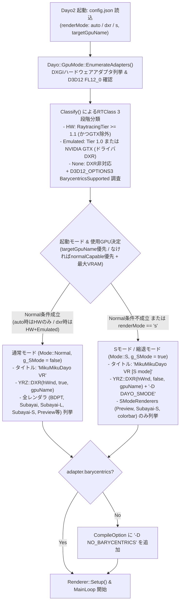
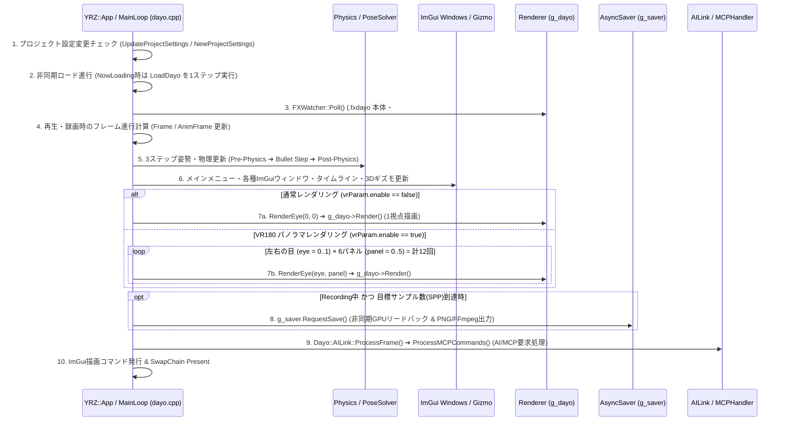
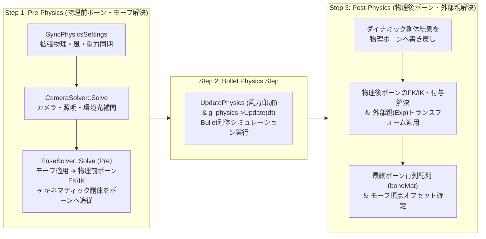
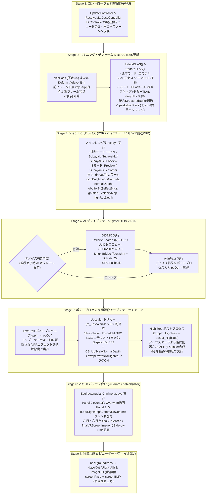
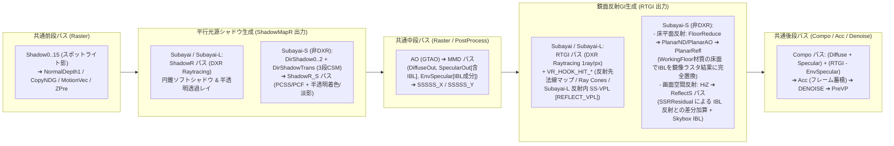
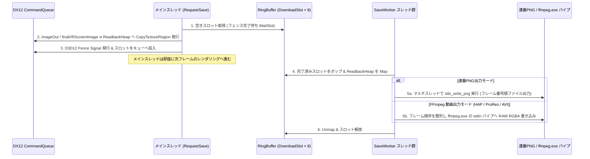
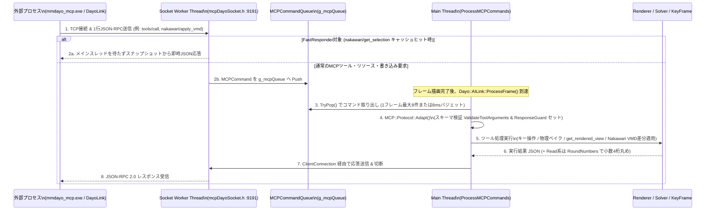

# MikuMikuDayo VR アーキテクチャ設計書 (Part 3: State Transition & Execution Flow)

## 1. ドキュメントの目的
本ドキュメントは、**MikuMikuDayo VR（MMDayo）**（`Ver1.4.0-r261122` 時点）の動的な振る舞い（起動時のGPUモード判定・アプリケーション状態遷移、1フレームのメインループ実行順序、3ステップのボーン/IK/物理ソルブフロー、7ステージレンダリングパイプラインと `Subayai-S` 縮退PBR構造、VR180 6パネル合成、非同期録画、およびAI/外部プロセス連携フロー）を定義する。

---

## 2. アプリケーション状態遷移と起動モード決定（State Transition & GPU Mode）

MMDayoの実行状態は、起動時に一度だけ決定される起動モード（**通常モード `Normal Mode`** または **縮退モード `S Mode` (`g_SMode`)**）のもとで、`NowLoading`（非同期シーンロード中）、`Playing`（プレビュー再生中）、`Recording`（連番画像またはFFmpeg動画書き出し中）、および通常の `Editing`（編集・静止画収束待機モード）の4状態と、サブモードである `VR180 Mode`（`vrParam.enable`）および `AI Link Mode`（`g_cfg.aiLinkEnabled`）の組み合わせで制御される。

```mermaid
stateDiagram-v2
    [*] --> Startup : WinMain / Dayo2 起動
    Startup --> GpuModeDecide : config.json 読込 ＆ Dayo：：GpuMode：：Decide()
    GpuModeDecide --> Editing : DXR初期化 (!g_SMode) ＆ 初期プロジェクト構築完了\n(Normal Mode または S Mode [S mode] 確定)

    state "通常・再生・録画ステート" as MainStates {
        Editing : Editing (編集・静止画蓄積)\nAnimation = false, Recording = false
        Loading : NowLoading (段階的シーンロード)\nLoadDayoContext ステートマシン実行\n(Sモード時はDXRレンダラをSubayai-S/Previewへ自動代替)
        Playing : Playing (リアルタイム再生)\nAnimation = true, Recording = false
        RecordingState : Recording (連番PNG / FFmpeg動画出力)\nAnimation = true, Recording = true

        Editing --> Loading : .dayo ファイルを開く
        Loading --> Editing : 全モデル・エフェクト読込完了

        Editing --> Playing : Playボタン / Spaceキー
        Playing --> Editing : Stopボタン / Spaceキー

        Editing --> RecordingState : Recordボタン押下\n(AsyncSaver初期化 & フレーム開始位置へ移動)
        RecordingState --> Editing : 最終フレーム到達 / ESC中断\n(AsyncSaver.Finish & FFmpegクローズ)
    end

    state "並列稼働サブシステム" as SubSystems {
        AILinkSub : AI Link Server (TCP 127.0.0.1:9191)\nフレーム末尾で ProcessMCPCommands() 実行
        FXWatchSub : FXWatcher & FXShaderCache ホットリロード監視\n.fxdayo 本体および #include 先 (.deps記録) の更新検知時に自動再コンパイル
    end
```

### 2.1 起動時のGPU能力調査と起動モード決定フロー（`gpuModeDayo.h`）

HWレイトレーシング（DXR）ユニットを持たないGPU（GeForce GTX 10/16系、Radeon RX 5000以前、内蔵GPU等）でも単一バイナリで安全に起動できるよう、`Dayo2()` の初期化フェーズで `Dayo::GpuMode::Decide()` が実行される。



### 2.2 各状態におけるレンダリング・時間進行の違い
1. **`Editing`（編集モード）**:
   - カメラやボーン、ライトが動いていない間は `cb.iSample` が毎フレームインクリメントされ、パストレーシング（`BDPT` 等）やマルチサンプル蓄積型レンダラ（`Subayai` / `Subayai-L` / `Subayai-S` のソフトシャドウ・SSR・AO）がフレームを跨いで蓄積・収束する。
   - 視線変更やギズモ操作が行われると `cb.iSample = 0` にリセットされ、再蓄積が始まる。
2. **`Playing`（プレビュー再生モード）**:
   - 実時間タイマー（`fpsWatch`）および音声再生位置（`g_player`）に同期して `AnimFrame`（浮動小数点フレーム）が進行し、毎フレーム1サンプル（`iSample = 0`）でリアルタイム描画を行う。
3. **`Recording`（録画モード）**:
   - 実時間とは切り離された固定タイムステップで1フレームずつ進行する。
   - 指定された目標サンプル数（SPP: Samples Per Pixel）に達するまで同一フレームで `cb.iSample` を回して収束させた後、デノイズ・ポストプロセスを経て `AsyncSaver` へフレームを送出し、次のフレームへ進む。

---

## 3. メインループ（1フレーム）の全体実行フロー

`dayo.cpp` の `MainLoop` ラムダ関数は、毎フレーム以下の順序で処理を実行する。



---

## 4. 3ステップ姿勢・IK・物理演算ソルブフロー

MMD互換のボーン・モーフ・IK・物理演算・付与（回転/移動付与）を破綻なく解決するため、MMDayoでは1フレームの姿勢更新を**3つのフェーズ**に分割して実行する。



### 物理ベイク処理（`BakePhysicsToKeys`）
- タイムラインツールやMCPツール `bake_physics` から物理ベイクが実行された場合、指定フレーム範囲（`start_frame` 〜 `end_frame`）を先頭から順番に上記3ステップでシミュレーションし、ダイナミック剛体によって動かされた物理ボーンのワールド/ローカル変換を逆算して、確定ボーンキーフレーム（`boneKeys`）へ書き込む。

---

## 5. 7ステージ レンダリングパイプライン（`Renderer::Render`）

`renDayo.h` の `Renderer::Render` は、通常モード（DXR有効）でもSモード（非DXR縮退モード）でも統一された**7ステージ**で実行される。



### 5.1 Subayai（DXRハイブリッド）と Subayai-S（非DXR縮退PBR）のバッファ契約アーキテクチャ

Stage 3 で用いられる主力PBRレンダラ `Subayai` / `Subayai-L` と、Sモード対応の縮退版 `Subayai-S` は、**`ShadowMapR`（平行光源可視率）・`RTGI`（鏡面反射GI）・`EnvSpecular`（差し引くべきIBL鏡面反射成分）の3つの内部バッファ契約を共通化**することで、`MMD`（直接光＋IBL＋拡散SH）、`SSSSS`、`Compo`、`Acc`、`DENOISE` といった大部分のシェーダパスと材質定義（`subayairencon.pmx`, `subalight.pmx`, `m/*.txt`）をそのまま共有する設計となっている。



- **VR独自拡張フックの分離（`SubayaiExtraHelper.hlsli`, `Subayai_L_Helper.hlsli`, `Subayai_L.libsonnet`）**:
  - 本家Subayaiの更新を取り込みやすくするため、VR版で拡張した処理（反射ヒット先での法線マップ適用・Ray Conesによるミップ選択、`Subayai-L` のSS-VPL・反射内VPL、FSR2/DLSS用 `VelocityMap` 生成、VRパノラマ面別 `PrevViewProjectionMatrix` 参照）は `VR_HOOK_*` マクロとして別ファイルに分離されている。

### 5.2 パイプライン上の重要設計ポイント
1. **ポストプロセス順序とアップスケーラの位置連動（Stage 5）**:
   - `g_edi.postprocessOrder` リスト内に配置されたアップスケーラモデル（`FSR2_Upscaler.pmx` または `DLSS3_5_Upscaler.pmx`）の位置が、そのまま**低解像度ポストプロセス領域**と**高解像度ポストプロセス領域**の境界線となる。
   - アップスケーラ実行時に `swapLowresToHighres` が切り替わり、後続のポストプロセスには自動的に高解像度バッファ（`ppIn_HighRes` / `ppOut_HighRes`）および拡大済み法線深度（`normalDepth_HighRes`）がバインドされる。
2. **FXLinkerによる32bitエフェクトマスク（`effectBits`）の伝搬**:
   - 各材質・各モデルの `effectBits` は Stage 3 のレンダリング時に `gbuffer1.z`（および `highResDepth`）へ書き込まれ、Stage 5 の `FXLinker` 自動生成コンポジットシェーダがビット演算によって「どのピクセルにどのポストプロセスを適用するか」を1パスで判定・合成する。
3. **VR180 6パネル・マルチFOV合成（Stage 6）**:
   - VR180モードでは、1眼あたり `Centor`（正面広角）、`Left`、`Right`、`Top`、`Buttom`、および正面中心部の解像度密度を高める `ReCentor`（狭角高精細）の計6パネルを透視投影でレンダリングし、`EquirectangularX_Inline.fxdayo` で正距円筒図法（Equirectangular 180°）へ重み付き合成する。
   - この際、FSR2のテンポラル履歴がパネル間で破綻しないよう、`fsr_viewidx = 1 + eye * 6 + panel`（1〜12）の独立したコンテキストが使用される。

---

## 6. 非同期録画・FFmpeg連携フロー（`AsyncSaver`）

録画（`Recording == true`）時のGPUリードバックボトルネックを解消するため、`asyncSaverDayo.h` の `AsyncSaver` は **8スロットのリングバッファ** と **ワーカースレッドプール** を用いたパイプライン並列処理を行う。



---

## 7. AI連携・外部プロセス通信フロー（MCP & AI中割り）

メニューバーの `AI Link` が `ON` の間、`mcpDayoSocket.h` のワーカースレッドが `127.0.0.1:9191` でJSON-RPC 2.0リクエストを受け付ける。DirectX 12リソースや `PoseSolver` への競合を防ぐため、**原則としてすべてのシーン読み書きはメインスレッド末尾の `ProcessMCPCommands()` で同期実行**される（ただし読み取り専用のキャッシュ照会のみ `g_fastResponder` で即時応答可能）。



### 7.1 MCP（Model Context Protocol）パイプラインの安全機構
1. **1フレームあたりの実行バジェット制御**:
   - 大量のコマンドが一度に届いてもGUIがフリーズしないよう、`ProcessMCPCommands()` は1フレームあたり最大8コマンドまたは経過時間8msでループを切り上げ、残りを次フレームへ持ち越す（ただし `get_rendered_view` のような重いコマンドも最低1件は必ず処理する）。
2. **`ResponseGuard` によるデッドロック防止**:
   - ハンドラ内で例外や早期リターンが発生しても、スコープ脱出時に必ずエラーレスポンスを返してソケットを閉じるため、クライアント側（`mmdayo_mcp.exe`）が無限待ちに陥らない。
3. **`get_rendered_view` によるマルチモーダル視覚フィードバック**:
   - AIが現在のビューポート画像を要求すると、`g_dayo->dayoOut`（VR時は `finalVRScreen`）からGPUリードバックを行い、`mcpDayoImage.h` で指定解像度へ縮小＋PNG/JPEG Base64エンコードして返却する。これによりAIは自身のポーズ付けやライティング結果を視覚的に確認しながら自律修正できる。

### 7.2 AI中割り（`mcpDayoNakawari.h` / `DayoLink`）の差分VMD連携フロー
1. **選択状態の常時スナップショット配信（`PublishSnapshot`）**:
   - 毎フレーム末尾で、現在選択中のモデル名・ボーン名・選択フレーム区間・キーフレーム数がスレッドセーフなスナップショットにコピーされる。これにより外部の `MMD-AINakawari`（0.6.0 / 0.7.0 両対応）は、MMDayoが重いレンダリング中であっても `nakawari/get_selection` をミリ秒単位でポーリングできる。
2. **一時VMDエクスポート（`nakawari/request_vmd`）**:
   - 対象モデルのボーン・モーフ・IK状態をローカルの一時VMDファイルへ書き出し、そのファイルパスと選択フレーム範囲を `MMD-AINakawari` へ返す。
3. **差分のみのスマートインポートと1ステップUndo（`nakawari/apply_vmd`）**:
   - AIが推論した中割り済みVMDを受け取ると、変更があったボーントラックのみを特定し、指定フレーム区間（`[start_frame, end_frame]`）の既存キーを消去して新しいキーフレームを挿入する。
   - この際、影響を受ける全ボーントラックのUndo記録に `pack = 1`（最終トラックに `pack = 2`）を付与することで、何十個のボーンがAIによって中割りされても、ユーザーは **`Ctrl+Z` 1回でAI適用前の状態へ完全にロールバック**できる。
